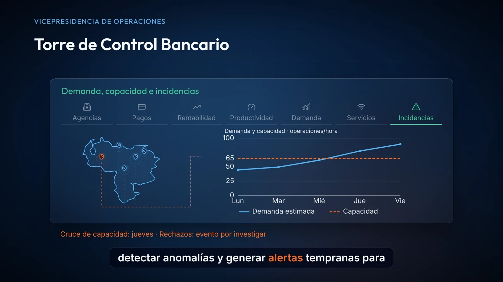
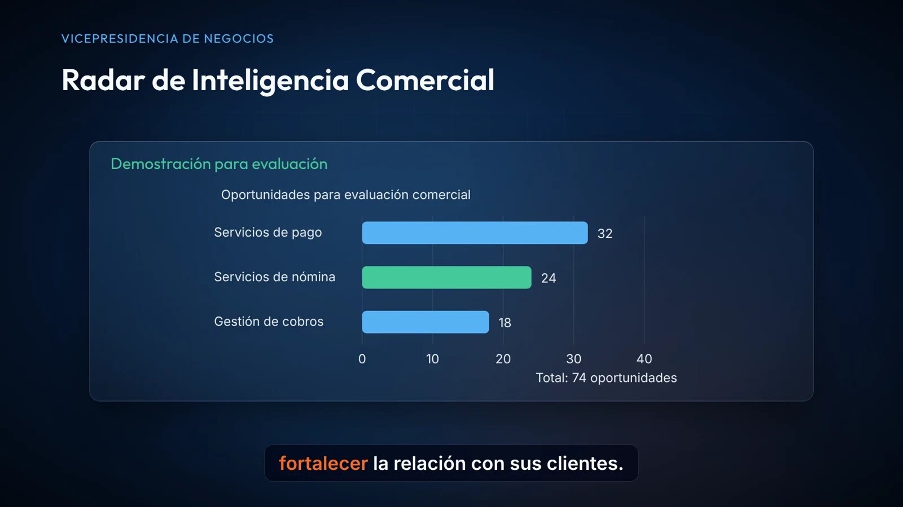
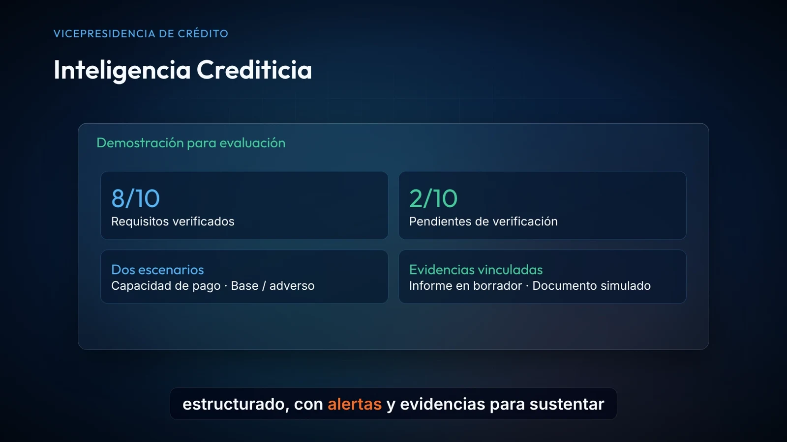
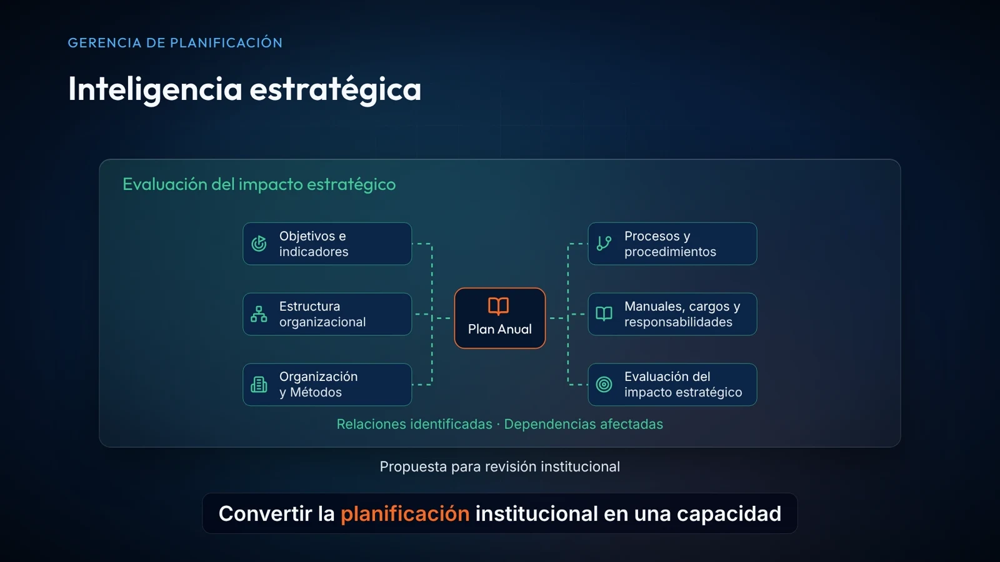
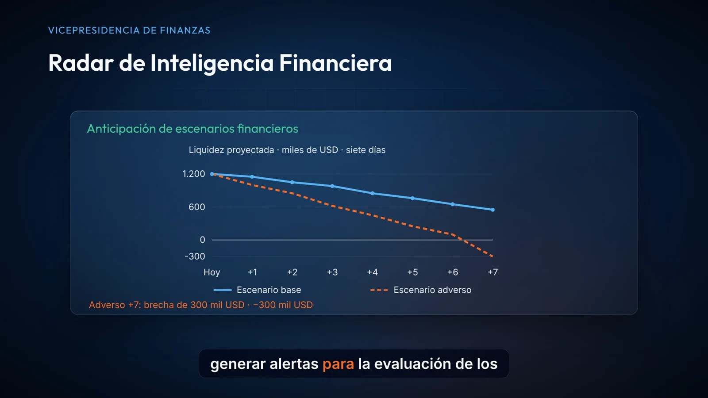
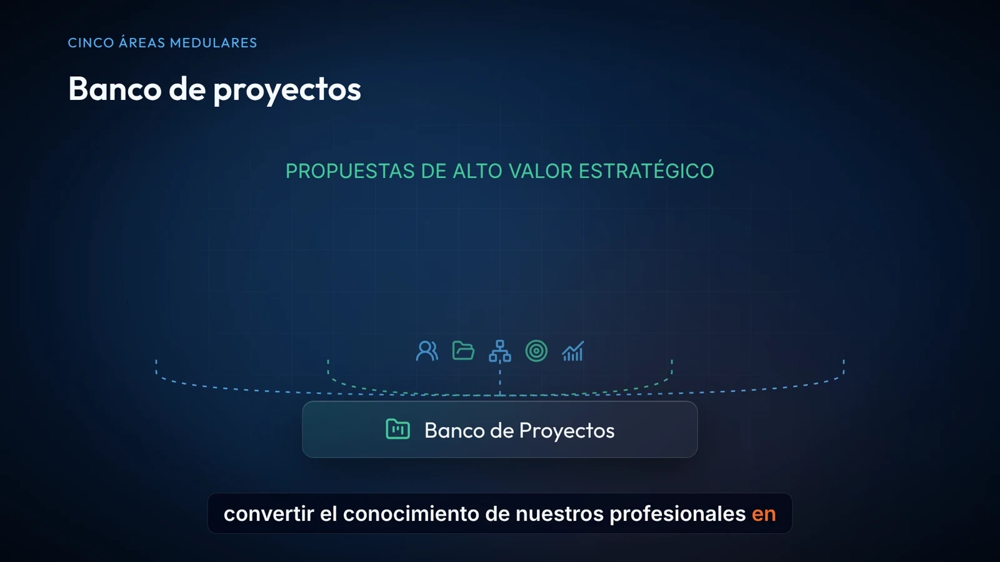
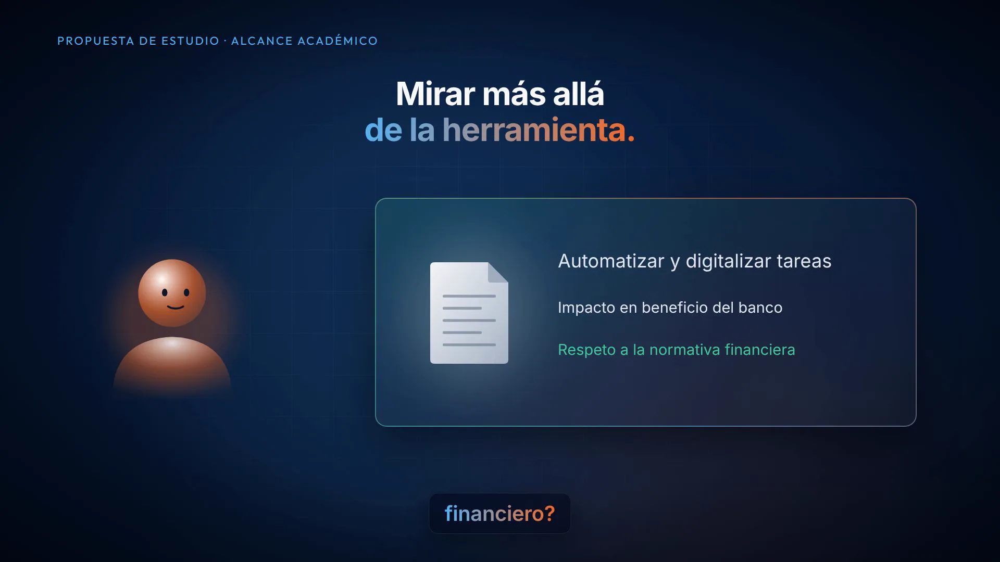
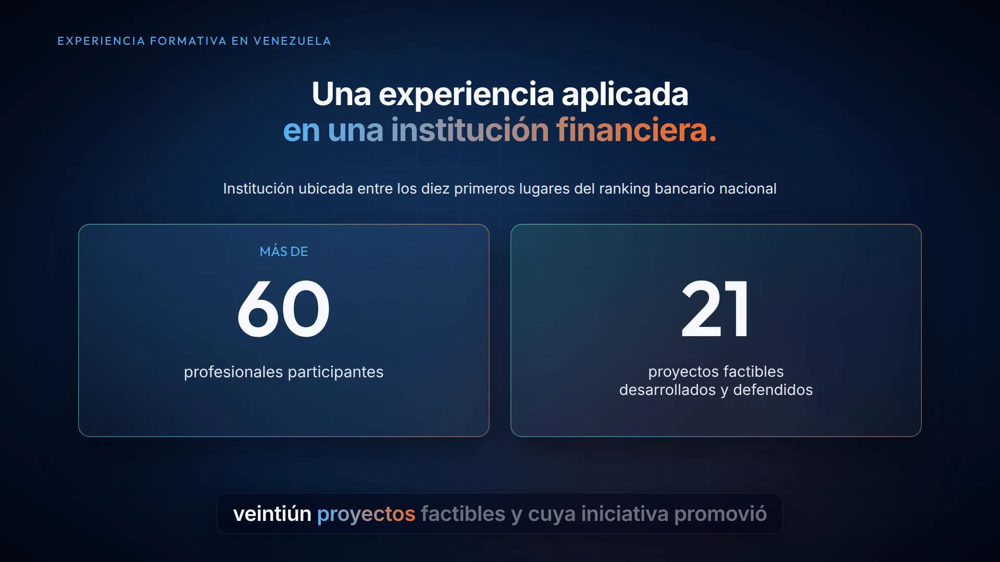
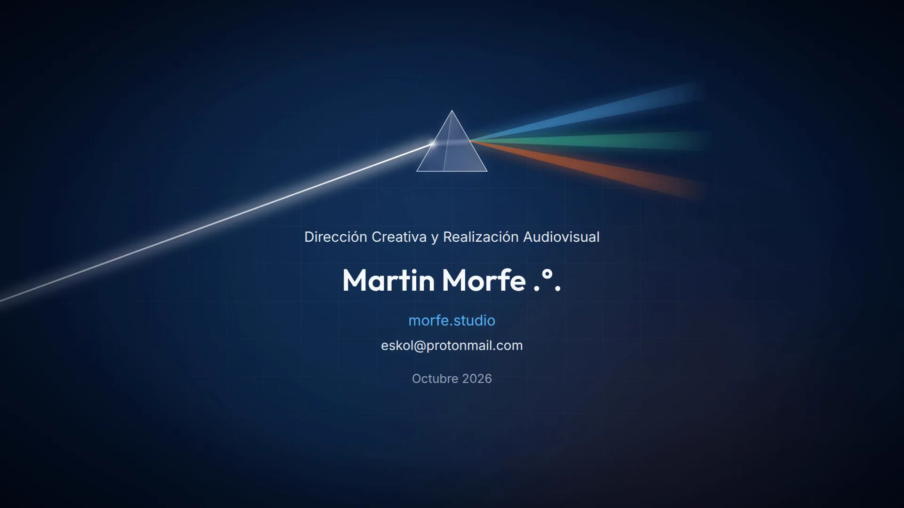
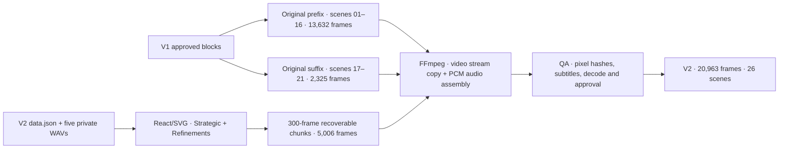

# Diplomado en Inteligencia Artificial Aplicada a la Banca

**V2.0.0 · Programmatic audiovisual engineering · React · SVG · Remotion · FFmpeg**
Martin Morfe .°. · **morfe.studio** · 2026

[](package.json)
[](package.json)
[](package.json)
[](src/v2/Refinements.tsx)
[](docs/v2/ENTORNO.txt)
[](deliverables/v2/approval.json)
[](deliverables/v2/approval.json)
[](docs/SCENE-BY-SCENE.md)
[](https://github.com/mmorfe-engineer/diplomado-ia-banca-motion/releases/tag/v2.0.0)
[](deliverables/v2/approval.json)
[](deliverables/v2/closure-validation.json)
[](deliverables/v2/qa-v2.json)
[](https://github.com/mmorfe-engineer/diplomado-ia-banca-motion/releases/tag/v2.0.0)
[](LICENSE)

[](https://youtu.be/IHxvrOALlcc)

[**▶ WATCH V2 ON YOUTUBE**](https://youtu.be/IHxvrOALlcc)

[](https://youtu.be/IHxvrOALlcc)

**V2 audiovisual product approved on 16 November 2026.** 26 scenes, 24 voice recordings and 11:38.767. This release extends the approved V1 film with five strategic banking cases while preserving every original video frame. The five new demonstrations use original NuevaMente Person components, functional Lucide icons and deterministic React/SVG dashboards.

[Watch V2 on YouTube](https://youtu.be/IHxvrOALlcc) · [V2 release](https://github.com/mmorfe-engineer/diplomado-ia-banca-motion/releases/tag/v2.0.0) · [V1 release](https://github.com/mmorfe-engineer/diplomado-ia-banca-motion/releases/tag/v1.0.0-pilot) · [Watch V1 on Vimeo](https://vimeo.com/user265304725/diplomado-ia-banca-vzla?share=copy&fl=sv&fe=ci) · [Español](README.md)

**Official V2 audiovisual publication:** [Watch the approved master on YouTube](https://youtu.be/IHxvrOALlcc). Private MP4 masters and voice recordings are not included in Git or release assets. Local delivery locations and integrity records are documented in [the closure record](docs/PROJECT-CLOSURE-V2.md).

## V1 → V2

| Verified aspect | V1 · v1.0.0-pilot | V2 · v2.0.0 |
|---|---|---|
| Narrative scope | Academic proposal, Isabel, prior banking experience and credits | V1 plus five autonomous strategic cases |
| Scenes / recordings | 21 / 19 | 26 / 24 |
| Frames at 30 fps | 15,957 | 20,963 |
| Exact duration | 531.900 s · 08:51.900 | 20,963/30 s · 11:38.767 |
| Cases | Isabel and academic project formulation | Commercial intelligence, credit, operations, strategic planning and finance |
| Graphics | Original Person, Glass, Prism and institutional SVG | Semantic icons, animated geolocation, impact graph, financial projections and five-area convergence |
| Technical evolution | Five approved render blocks | Independent V2 compositions, 300-frame checkpoints, stream-copy video insertion |
| Approval | Approved pilot | Definitive director approval, 2026-11-16 |
| Watch the film | [Vimeo V1](https://vimeo.com/user265304725/diplomado-ia-banca-vzla?share=copy&fl=sv&fe=ci) | [YouTube V2](https://youtu.be/IHxvrOALlcc) |
| Release | [v1.0.0-pilot](https://github.com/mmorfe-engineer/diplomado-ia-banca-motion/releases/tag/v1.0.0-pilot) | [v2.0.0](https://github.com/mmorfe-engineer/diplomado-ia-banca-motion/releases/tag/v2.0.0) |

Both versions are 1920×1080, 30 fps, H.264/AAC stereo. V2 adds 5,006 frames (166.866667 s). Its 13,632 original prefix frames and 2,325 suffix frames were checked pixel-for-pixel against V1. Original audio samples are preserved in the PCM assembly intermediate; final AAC audio is encoded again.

## Approved-master gallery

All V2 images below come directly from the SHA-256-verified approved master, not intermediate renders. [Frame provenance](docs/media/v2/frames.json).

| Radar de Inteligencia Comercial | Inteligencia Crediticia | Torre de Control Bancario |
|---|---|---|
|  |  |  |
| **Simulador de Impacto Estratégico** | **Radar de Inteligencia Financiera** | **Cinco áreas → Banco de Proyectos** |
|  |  |  |

### Preserved V1 gallery

| Apertura | Isabel | Antecedente bancario | Créditos |
|---|---|---|---|
| [](https://vimeo.com/user265304725/diplomado-ia-banca-vzla?share=copy&fl=sv&fe=ci) |  |  |  |

## Architecture and surgical insertion



The core components and V1 scene files stay unchanged. V2 inserts **16A–16E after Isabel and before the banking precedent**. Scene 17/18 retains its continuous original recording. See [architecture](docs/ARCHITECTURE.md), [narrative sequence](docs/SCENE-BY-SCENE.md) and [word synchronization](docs/AUDIO-SYNCHRONIZATION.md).

## Reproduce and modify

```bash
git clone https://github.com/mmorfe-engineer/diplomado-ia-banca-motion.git
cd diplomado-ia-banca-motion
npm ci
npm run typecheck
npm run docs:check
npm run studio
```

Studio registers `V2-negocios`, `V2-credito`, `V2-operaciones`, `V2-planificacion`, `V2-finanzas` and `DiplomadoIA-V2-Estrategico`, alongside the original V1 review block.

```bash
# V1: select the original block (other choices: 03-06, 07-10, 11-16)
npm run studio -- --props='{"block":"17-21"}'

# Authorized private media required for full audiovisual output
npm run v2:render
npm run v2:assemble
npm run v2:qa
```

**Publicly reproducible:** dependency installation, typecheck, documentation checks and code inspection. Private narration/SFX, approved V1 video tracks and PCM, original fonts/network access and local browser/FFmpeg configuration are necessary for production. An authorized source tree is not a guarantee of a bit-identical re-render. [Exact commands and boundaries](docs/REPRODUCIBILITY.md) · [Build/render](docs/BUILD-AND-RENDER.md) · [Modification guide](docs/MODIFICATION-GUIDE.md).

## Verification and custody

| Evidence | Record |
|---|---|
| Definitive approval and exact metrics | [approval.json](deliverables/v2/approval.json) |
| Technical QA and V1 pixel preservation | [qa-v2.json](deliverables/v2/qa-v2.json) |
| Publication manifests | [MANIFEST.json](deliverables/v2/MANIFEST.json) |
| Final Spanish subtitles | [diplomado-ia-v2.srt](deliverables/v2/diplomado-ia-v2.srt) |
| Local and clean-environment validation | [closure-validation.json](deliverables/v2/closure-validation.json) |
| Scope, decisions, release and recovery | [PROJECT-CLOSURE-V2.md](docs/PROJECT-CLOSURE-V2.md) |

V2 SHA-256: `06665a81e4968434acac12cb9c319d71d1787b42fceb1b8e207076fdcf4d8be5`
V1 SHA-256: `0f9d610c65a5663a3ae0ab380c309fcf256339997ee4f6d4c5f6c07b1b7c9b19`

Automated QA includes full decoding and original-frame comparison; internal image QA used actual-frame sampling. Definitive audiovisual approval was provided separately by the director. Typecheck is not a replacement for runtime/media QA. [Methods and limitations](docs/QA-AND-VALIDATION.md).

## Scope and rights

The five cases are conceptual demonstrations and project proposals, **not deployed banking solutions**. Figures, positions and map markers are illustrative and do not report actual bank results. Outputs support human evaluation. [Asset provenance](docs/ASSET-PROVENANCE.md).

© 2026 Martin Morfe · morfe.studio. All rights reserved over original audiovisual elements. The existing [LICENSE](LICENSE) remains unchanged: MIT applies only to source code; voice, names, logos and private media retain their existing rights. No new open license is granted for audiovisual assets.

**Dirección Creativa y Realización Audiovisual**
Martin Morfe .°. · morfe.studio · [eskol@protonmail.com](mailto:eskol@protonmail.com)

[CREDITS](docs/CREDITS.md) · [Third-party notices](docs/THIRD_PARTY_NOTICES.md) · [Release process](docs/RELEASE-PROCESS.md) · [Changelog](docs/CHANGELOG.md)
