# Applied Artificial Intelligence in Banking Diploma

**Programmatic audiovisual engineering · React · TypeScript · Remotion · 21 scenes**  
Martin Morfe .°. · morfe.studio · October 2026

[](https://react.dev/)
[](https://www.typescriptlang.org/)
[](https://www.remotion.dev/)
[](deliverables/qa-tecnico.json)
[](docs/PROJECT-STATUS.md)

---

[](https://vimeo.com/user265304725/diplomado-ia-banca-vzla?share=copy&fl=sv&fe=ci)

## [▶ WATCH THE FILM — VIMEO](https://vimeo.com/user265304725/diplomado-ia-banca-vzla?share=copy&fl=sv&fe=ci)

> This image links to Vimeo. GitHub does not host the video player or file.

---

## Table of contents

- [Summary](#summary)
- [Objectives](#objectives)
- [Scope and limitations](#scope-and-limitations)
- [Features](#features)
- [Technology stack](#technology-stack)
- [Gallery](#gallery)
- [Architecture](#architecture)
- [Production pipeline](#production-pipeline)
- [Scene overview](#scene-overview)
- [Visual system](#visual-system)
- [Audio synchronization](#audio-synchronization)
- [Repository structure](#repository-structure)
- [Installation](#installation)
- [Local preview](#local-preview)
- [Rendering](#rendering)
- [Quality assurance](#quality-assurance)
- [Modification guide](#modification-guide)
- [Reproducibility](#reproducibility)
- [Verified deliverables](#verified-deliverables)
- [Credits](#credits)
- [Rights and licensing](#rights-and-licensing)
- [Author and contact](#author-and-contact)

---

## Summary

An **8 min 51 s** audiovisual production presenting the academic proposal for the *Applied Artificial Intelligence in Banking Diploma*, a 120-hour program designed for Venezuelan banking professionals.

Every frame is a React function. There is no video editor: animations, typography, colors, transitions, and captions are computed mathematically in TypeScript and exported to H.264/AAC via Remotion and FFmpeg.

The film is structured in **21 scenes** organized across **5 render blocks**, narrated by **19 voice recordings** synchronized word-by-word using automatic transcription data.

---

## Objectives

- Present the academic program to institutional decision-makers.
- Document the technical architecture of the motion graphics engine for reproduction, modification, and extension.
- Provide a reference case for programmatic audiovisual engineering in React/Remotion with voice synchronization.
- Serve as a technical and creative portfolio of corporate audiovisual production generated from code.

---

## Scope and limitations

| Aspect | Description |
|---|---|
| **Work type** | Academic audiovisual production and institutional proposal |
| **Isabel assistant** | Simulation proposal; not an operational banking application |
| **Prior results** | 60+ professionals, 21 feasible projects; some under review |
| **No invented ROI** | No financial returns or production implementations are claimed |
| **Voice and master** | Not distributed in this public repository; available on Vimeo |
| **Full render** | Requires prepared WAV files, FFmpeg, and path review |

---

## Features

- **21 React scenes** with reusable components and mathematically computed animations
- **Word-level synchronization**: real-time captions linked to Whisper transcription timestamps
- **Cohesive visual system**: 5-color palette, 2 typeface families, Glass panels, Prism effects
- **Interactive SVG**: institutional iconography, vector people, particle effects
- **19 voice recordings** + sound effects (SFX) triggered by word cues
- **Documented production pipeline**: block rendering → FFmpeg assembly → technical QA
- **SRT subtitles** generated from the same synchronization data
- **Automated technical QA**: dimension, duration, codec, and bitrate verification

---

## Technology stack

| Layer | Technology | Version |
|---|---|---|
| Video framework | Remotion | 4.0.538 |
| UI | React | 19.1.0 |
| Language | TypeScript | 5.8.3 |
| Iconography | Lucide React | 0.468.0 |
| Typefaces | Google Fonts (Inter, Outfit) via Remotion | — |
| Geography (SVG) | d3-geo, topojson-client, world-atlas | ^3.1 |
| Assembly and audio | FFmpeg / ffprobe | system |
| Transcription | Whisper (OpenAI) | system |
| QA | Python 3, ffprobe | system |
| Build | npm (Node.js) | lockfile included |

---

## Gallery

Real frames extracted from the approved master.

| Opening | Isabel | Principles | Alliance |
|:---:|:---:|:---:|:---:|
|  | 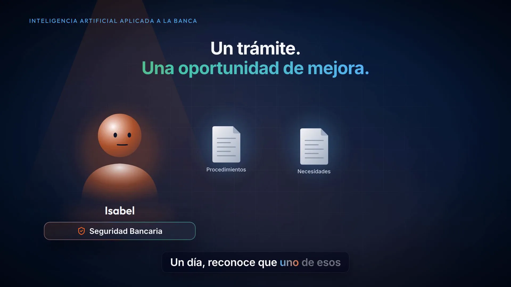 | 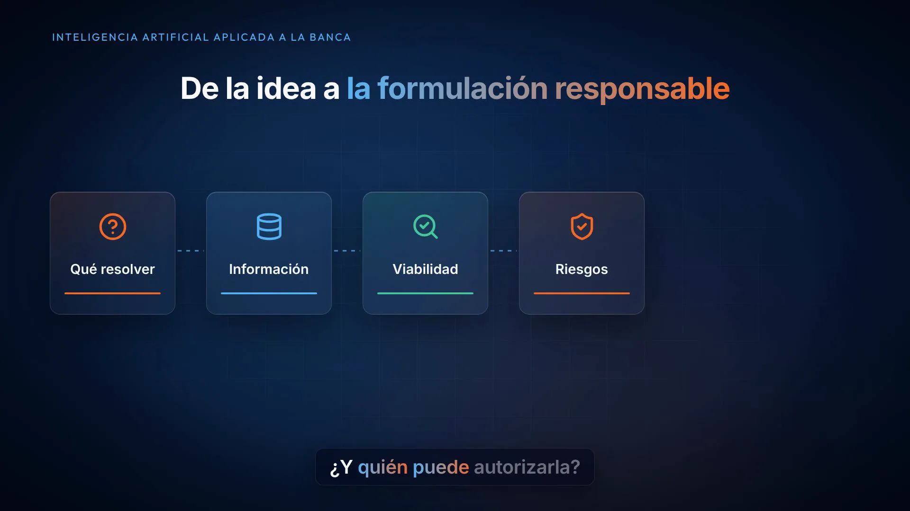 | 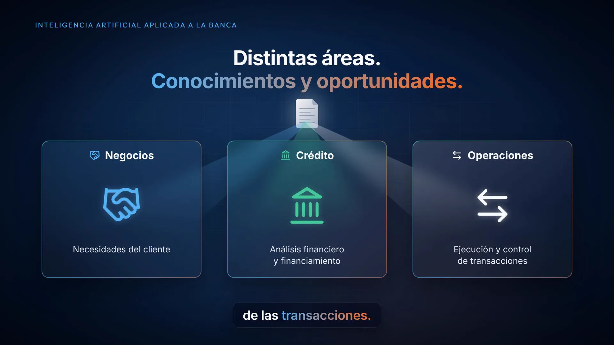 |
| **Functional routes** | **120 hours** | **20/20/60 evaluation** | **Conversational assistant** |
| 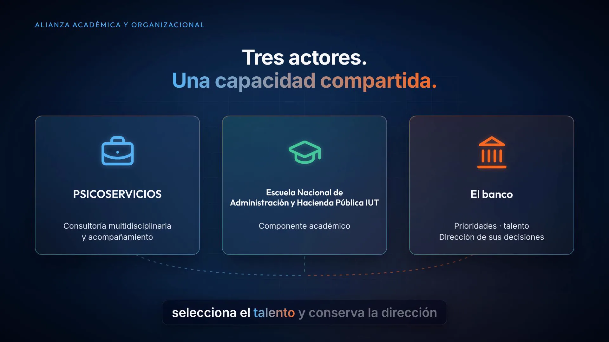 | 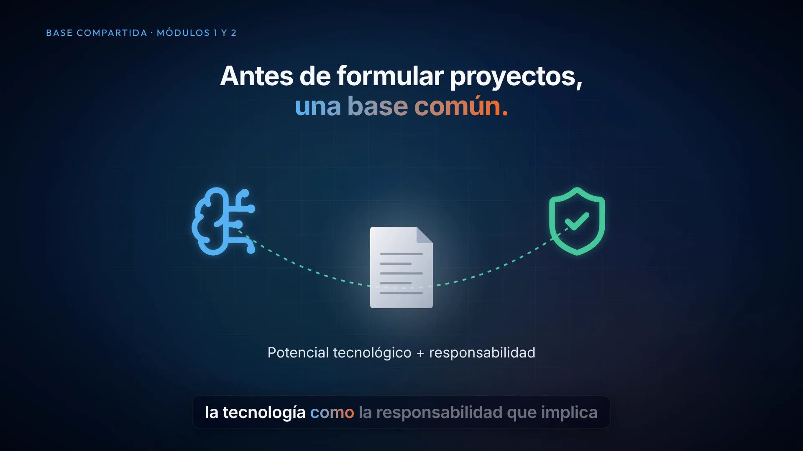 | 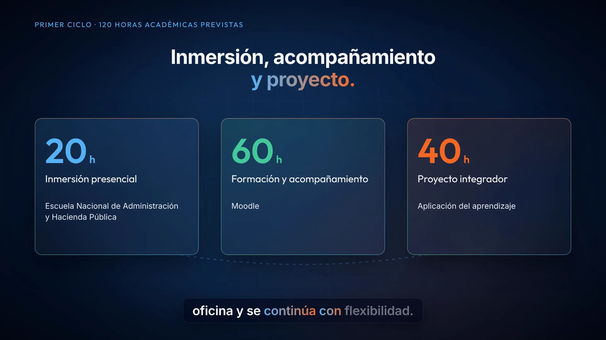 | 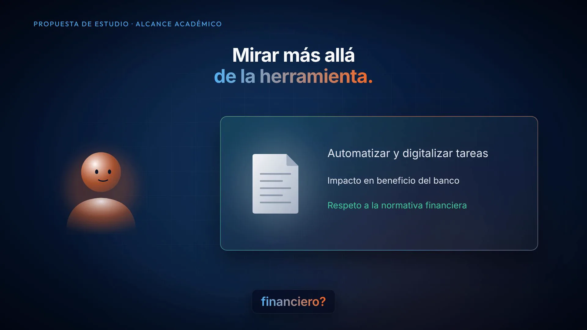 |
| **Prior experience** | **Projects under review** | **Narrative closing** | **Credits** |
| 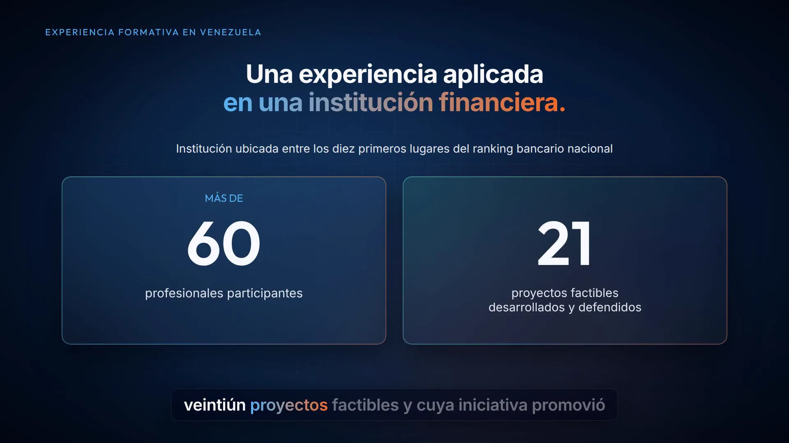 | 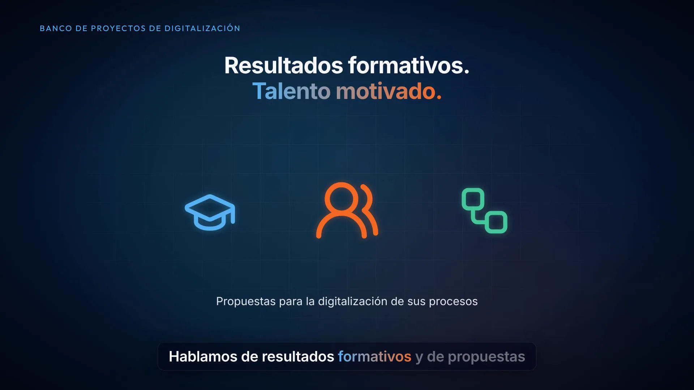 | 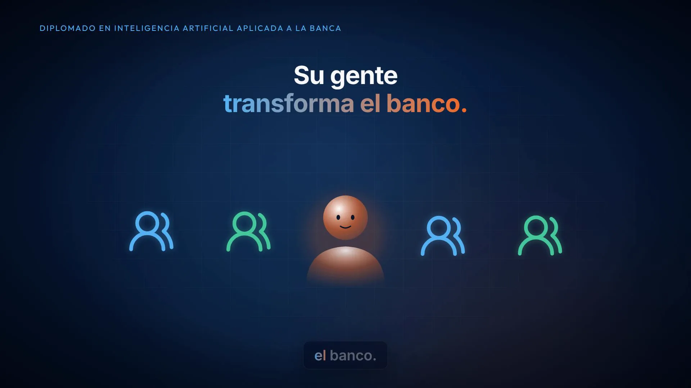 | 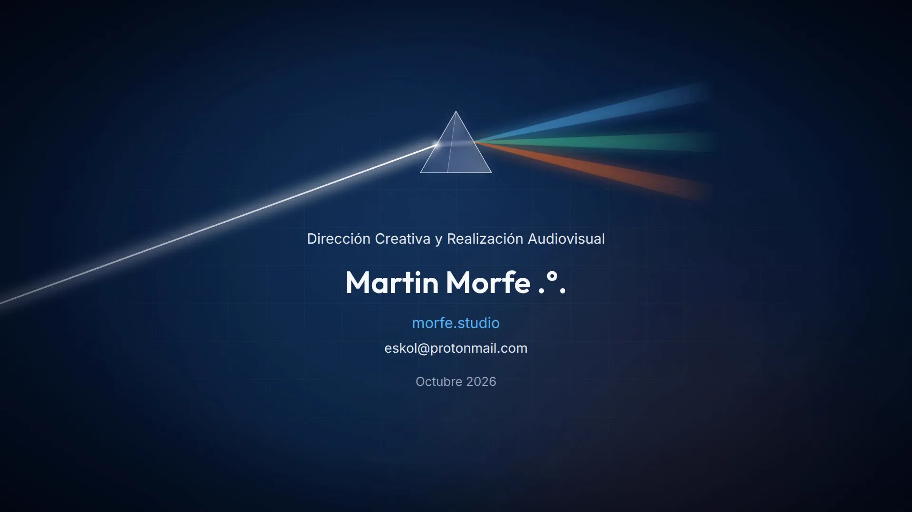 |

---

## Architecture

```mermaid
flowchart TD
  subgraph Content
    Script[Script and voice recording]
    Whisper[Whisper transcription]
    JSON[words.json / voices.json]
  end
  subgraph Engine
    Locale[locale.ts / diplomado.tsx]
    Timeline[timeline.ts — scene durations]
    Sync[sync.ts — cueAt per word]
    Theme[theme.ts — palette and typefaces]
  end
  subgraph Scenes
    S1_6[Scenes 1–6 · S1–S6.tsx]
    B07[Block07_10.tsx · S7–S10]
    B11[Block11_16.tsx · S11–S16]
    B17[Block17_21.tsx · S17–S21]
  end
  subgraph FX
    FX[fx/ · Background · Glass · Title · Prism · Captions · InstitutionalIcon]
  end
  subgraph Output
    Root[Root.tsx · Composition]
    Remotion[Remotion block render]
    FFmpeg[FFmpeg assembly and normalization]
    QA[Python QA / ffprobe]
    Master[H.264/AAC master]
  end
  Script --> Whisper --> JSON --> Locale --> Timeline & Sync
  Timeline & Sync --> S1_6 & B07 & B11 & B17
  Theme --> FX --> S1_6 & B07 & B11 & B17
  S1_6 & B07 & B11 & B17 --> Root --> Remotion --> FFmpeg --> QA --> Master
```

---

## Production pipeline

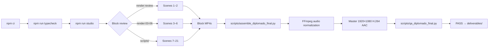

---

## Scene overview

| # | On-screen label | Source |
|---:|---|---|
| 01 | INTELIGENCIA ARTIFICIAL APLICADA A LA BANCA | S1.tsx |
| 02 | Isabel — human component | S2.tsx |
| 03 | Learning principles | S3.tsx |
| 04 | Institutional alliance | S4.tsx |
| 05 | Training routes (dual voice v5a+v5b) | S5.tsx |
| 06 | Academic structure | S6.tsx |
| 07 | ALIANZA ACADÉMICA Y ORGANIZACIONAL | Block07_10.tsx |
| 08 | BASE COMPARTIDA · MÓDULOS 1 Y 2 | Block07_10.tsx |
| 09 | CUATRO RUTAS FUNCIONALES | Block07_10.tsx |
| 10 | EVALUACIÓN DEL APRENDIZAJE | Block07_10.tsx |
| 11 | PRIMER CICLO · 120 HORAS ACADÉMICAS PREVISTAS | Block11_16.tsx |
| 12 | SEGUNDO CICLO · DE LA OPORTUNIDAD A LA PROPUESTA | Block11_16.tsx |
| 13 | ISABEL · SEGURIDAD BANCARIA | Block11_16.tsx |
| 14 | PROPUESTA DE ESTUDIO · ALCANCE ACADÉMICO | Block11_16.tsx |
| 15 | SIMULACIÓN ACADÉMICA · SIN CONEXIÓN A SISTEMAS BANCARIOS | Block11_16.tsx |
| 16 | RESULTADO EDUCATIVO · PROPUESTA PARA EVALUACIÓN | Block11_16.tsx |
| 17 | EXPERIENCIA FORMATIVA EN VENEZUELA | Block17_21.tsx |
| 18 | BANCO DE PROYECTOS DE DIGITALIZACIÓN | Block17_21.tsx |
| 19 | EMBAJADORES DIGITALES · CONTRIBUCIÓN PROFESIONAL | Block17_21.tsx |
| 20 | DIPLOMADO EN IA APLICADA A LA BANCA — CLOSING | Block17_21.tsx |
| 21 | AUDIOVISUAL CREDITS | Block17_21.tsx |

> Scenes 17 and 18 share the continuous recording `v17_18.wav`. Scene 21 is silent (credit sequence). See [SCENE-BY-SCENE.md](docs/SCENE-BY-SCENE.md) for durations and word cues.

---

## Visual system

| Token | Value | Use |
|---|---|---|
| `C.bg` | `#06162F` | Primary background (night) |
| `C.blue` | `#56B3F3` | Digital element, controls, corporate blue |
| `C.orange` | `#F46A25` | Human element, Isabel, accent orange |
| `C.green` | `#45C99A` | Proposal element, action, green |
| `C.yellow` | `#F7FAFF` | Title text, warm white |

**Typefaces:** Inter (body, 300–800) · Outfit (headings, 400–700) — loaded from Google Fonts via `@remotion/google-fonts`.

**Reusable FX components:** `Background` · `Glass` (glassmorphism panel with tint) · `Title` (with `Grad` gradient text) · `Prism` (light dispersion) · `Captions` (word-level subtitles) · `InstitutionalIcon` (Lucide icon with SVG glow) · `Person` (vector human figure) · `Doc` (animated SVG document) · `Sfx` (sound effect trigger).

See [VISUAL-SYSTEM.md](docs/VISUAL-SYSTEM.md) for full detail.

---

## Audio synchronization

```
words.json          voices.json
[word, t_start, t_end][]   { "v1": 27.010625, ... }
        ↓
sync.ts cueAt(voice, word)   →  absolute time within recording
timeline.ts scenePre(id)     →  scene start offset in the film
        ↓
at = scenePre("s7") + cueAt("v7", "fortalecer")
        ↓
prog(t, at, duration)        →  [0..1] for animation
```

Each scene computes its cues at render time. Data comes from Whisper transcription and was manually verified against the approved recording. See [AUDIO-SYNCHRONIZATION.md](docs/AUDIO-SYNCHRONIZATION.md).

---

## Repository structure

```
diplomado-ia-banca-motion/
├── src/
│   ├── index.ts              # Remotion entrypoint
│   ├── Root.tsx              # composition registry
│   ├── Video.tsx             # main sequencer
│   ├── timeline.ts           # scene duration calculator
│   ├── sync.ts               # cueAt — word index to time
│   ├── locale.ts             # locale selector
│   ├── lib.ts                # utilities (prog, keys, useT, FPS)
│   ├── theme.ts              # color palette C and typefaces
│   ├── locales/
│   │   ├── diplomado.tsx     # pilot locale (blocks 01–21)
│   │   ├── diplomado/
│   │   │   ├── words.json    # word timestamps (Whisper)
│   │   │   └── voices.json   # recording durations (ffprobe)
│   │   └── es/, en/          # reference locales
│   ├── scenes/
│   │   ├── S1.tsx – S8.tsx   # individual scenes (1–8)
│   │   └── diplomado/
│   │       ├── Block07_10.tsx   # scenes 7–10
│   │       ├── Block11_16.tsx   # scenes 11–16
│   │       └── Block17_21.tsx   # scenes 17–21
│   ├── fx/
│   │   ├── index.tsx         # Background, Glass, Title, Prism, Grad, Sfx, Doc, Person
│   │   ├── Captions.tsx      # word-level caption component
│   │   ├── InstitutionalIcon.tsx  # institutional iconography
│   │   └── team.tsx          # people composition
│   └── ui/App.tsx            # auxiliary UI
├── public/
│   ├── voice/diplomado/      # v1–v20 + v17_18.wav  [.gitignore]
│   └── sfx/                  # sound effect WAV files [.gitignore]
├── scripts/                  # render, assembly, QA, transcription
├── docs/
│   ├── media/                # WebP gallery frames
│   ├── editorial/            # script versions and approvals
│   └── *.md                  # technical documentation
├── deliverables/
│   ├── diplomado-ia-01-21-final.mp4  [.gitignore — 90 MB]
│   ├── diplomado-ia-01-21.srt        # verified subtitles
│   ├── MANIFEST.json                 # SHA-256 hashes
│   └── qa-*.json                     # QA reports
├── README.md                 # Spanish README
├── README.en.md              # this file
├── package.json
├── package-lock.json
└── tsconfig.json
```

---

## Installation

```bash
# Clone
git clone https://github.com/mmorfe-engineer/diplomado-ia-banca-motion.git
cd diplomado-ia-banca-motion

# Install dependencies (use the lockfile for reproducibility)
npm ci
```

**System requirements:**

| Tool | Use |
|---|---|
| Node.js ≥ 18 | npm ci, Remotion |
| FFmpeg + ffprobe | render, assembly, QA |
| Python 3 | QA and assembly scripts |
| OpenAI Whisper | only for re-transcription (optional) |

---

## Local preview

```bash
# Type checking
npm run typecheck

# Open Remotion Studio (browser)
npm run studio
```

The studio opens at `http://localhost:3000`. The default composition shows scenes 1–2 (`DiplomadoIA-Revision01-02`). For other scenes, pass `--props='{"block":"03-06"}'` or use the corresponding scripts.

> **Note:** the studio requires WAV files in `public/voice/diplomado/` and `public/sfx/`. Without them, audio will not play but animations can be previewed.

---

## Rendering

The `npm run render` commands produce **block reviews**, not the complete film. Full pilot rendering requires:

1. Prepared WAV files in `public/voice/` and `public/sfx/`
2. FFmpeg installed on the system
3. Running blocks sequentially with scripts in `scripts/`
4. Assembly with `scripts/assemble_diplomado_final.py`

```bash
# Quick preview of scenes 1–2
npm run render:review

# Block 03–06 review
npm run render:03-06
```

See [BUILD-AND-RENDER.md](docs/BUILD-AND-RENDER.md) for the complete pilot render process.

---

## Quality assurance

```bash
# TypeScript verification
npm run typecheck

# Technical QA of master (ffprobe)
python3 scripts/qa_diplomado_final.py

# Institutional character audit
node scripts/audit_institutional.mjs
```

QA reports are in `deliverables/qa-tecnico.json`, `deliverables/qa-visual.json`, and `deliverables/qa-final.json`. The master has technical QA PASS; visual review was by sampling, not continuous human viewing. See [QA-AND-VALIDATION.md](docs/QA-AND-VALIDATION.md).

---

## Modification guide

| Task | File |
|---|---|
| Change scene text | `src/scenes/diplomado/Block*.tsx` or `src/scenes/S*.tsx` |
| Change colors | `src/theme.ts` |
| Change typefaces | `src/theme.ts` + `@remotion/google-fonts` |
| Update word cues | `src/locales/diplomado/words.json` |
| Change recording duration | `src/locales/diplomado/voices.json` |
| Add a scene | `src/locales/diplomado.tsx` + new component |
| Change scene timing | `src/locales/diplomado.tsx` (pre/tail) |

See [MODIFICATION-GUIDE.md](docs/MODIFICATION-GUIDE.md) for step-by-step instructions.

---

## Reproducibility

Source code, synchronization data, and configuration are reproducible. Resources **not in this repository**:

| Resource | Reason | How to obtain |
|---|---|---|
| `public/voice/diplomado/*.wav` | Original recordings (private rights) | Contact the author |
| `public/sfx/*.wav` | Sound effects (generated locally) | `npm run sfx` |
| `deliverables/*.mp4` | Approved master (90 MB) — see Vimeo | [Vimeo](https://vimeo.com/user265304725/diplomado-ia-banca-vzla?share=copy&fl=sv&fe=ci) |

See [REPRODUCIBILITY.md](docs/REPRODUCIBILITY.md) for the complete procedure.

---

## Verified deliverables

| File | Description |
|---|---|
| `deliverables/diplomado-ia-01-21.srt` | Spanish subtitles, verified |
| `deliverables/MANIFEST.json` | SHA-256 hashes of master and deliverables |
| `deliverables/qa-tecnico.json` | ffprobe report: dimensions, fps, codecs, bitrate |
| `deliverables/qa-visual.json` | Visual review by frame sampling |
| `deliverables/qa-final.json` | Consolidated QA summary |

The master `diplomado-ia-01-21-final.mp4` is not in the repository (rights and size: 90 MB). Available on Vimeo.

---

## Credits

```
AUDIOVISUAL CREDIT
Creative Direction and Audiovisual Production
Martin Morfe .°. · morfe.studio
eskol@protonmail.com
October 2026
```

Academic program: Applied Artificial Intelligence in Banking Diploma.  
Academic and institutional collaboration: PSICOSERVICIOS · Escuela Nacional de Administración y Hacienda Pública IUT.

See [CREDITS.md](docs/CREDITS.md) and [THIRD_PARTY_NOTICES.md](docs/THIRD_PARTY_NOTICES.md).

---

## Rights and licensing

© 2026 Martin Morfe · morfe.studio. All rights reserved for original elements.

- **Source code**: the original React/TypeScript components are the author's property.
- **Voice recordings**: private rights; not distributed in this repository.
- **Master MP4**: not distributed under an open license; available on Vimeo for viewing.
- **Third-party dependencies**: retain their own licenses (MIT, ISC, Apache 2.0 as applicable).
- **Typefaces**: Inter and Outfit under OFL 1.1; loaded at render time from Google Fonts.

Public redistribution of individual resources requires specific rights verification. See [ASSET-PROVENANCE.md](docs/ASSET-PROVENANCE.md) and [SECURITY.md](docs/SECURITY.md).

---

## Author and contact

**Martin Morfe .°. — morfe.studio**  
Creative Direction and Audiovisual Production  
[eskol@protonmail.com](mailto:eskol@protonmail.com)

GitHub: [mmorfe-engineer](https://github.com/mmorfe-engineer)
