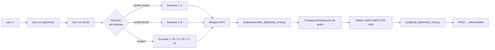

# Diplomado en Inteligencia Artificial Aplicada a la Banca

**Ingeniería audiovisual programática · React · TypeScript · Remotion · 21 escenas**  
Martin Morfe .°. · morfe.studio · Octubre de 2026

[](https://react.dev/)
[](https://www.typescriptlang.org/)
[](https://www.remotion.dev/)
[](deliverables/qa-tecnico.json)
[](docs/PROJECT-STATUS.md)

---

[](https://vimeo.com/user265304725/diplomado-ia-banca-vzla?share=copy&fl=sv&fe=ci)

## [▶ VER EL FILM — VIMEO](https://vimeo.com/user265304725/diplomado-ia-banca-vzla?share=copy&fl=sv&fe=ci)

> La imagen enlaza a Vimeo. GitHub no aloja el reproductor ni el archivo de video.

---

## Contenido

- [Resumen](#resumen)
- [Objetivos](#objetivos)
- [Alcance y limitaciones](#alcance-y-limitaciones)
- [Características](#características)
- [Stack tecnológico](#stack-tecnológico)
- [Galería](#galería)
- [Arquitectura](#arquitectura)
- [Pipeline de producción](#pipeline-de-producción)
- [Escenas: panorama general](#escenas-panorama-general)
- [Sistema visual](#sistema-visual)
- [Sincronización de audio](#sincronización-de-audio)
- [Estructura del repositorio](#estructura-del-repositorio)
- [Instalación](#instalación)
- [Vista previa local](#vista-previa-local)
- [Render](#render)
- [Control de calidad](#control-de-calidad)
- [Guía de modificación](#guía-de-modificación)
- [Reproducibilidad](#reproducibilidad)
- [Entregables verificados](#entregables-verificados)
- [Créditos](#créditos)
- [Derechos](#derechos)
- [Autor y contacto](#autor-y-contacto)

---

## Resumen

Producción audiovisual de **8 min 51 s** que presenta la propuesta académica del *Diplomado en Inteligencia Artificial Aplicada a la Banca*, un programa de 120 horas diseñado para profesionales del sector bancario venezolano.

Cada fotograma es una función de React. No existe un editor de video: las animaciones, tipografías, colores, transiciones y captions se calculan matemáticamente en TypeScript y se exportan a H.264/AAC mediante Remotion y FFmpeg.

El film se articula en **21 escenas** organizadas en **5 bloques de render** y está narrado por **19 locuciones de voz** sincronizadas a nivel de palabra mediante datos de transcripción automática.

---

## Objetivos

- Presentar el programa académico del Diplomado IA Bancaria a decisores institucionales.
- Documentar la arquitectura técnica del motor de motion graphics para su reproducción, modificación y extensión.
- Ofrecer un caso de referencia de ingeniería audiovisual programática en React/Remotion con sincronización de voz.
- Servir como portafolio técnico y creativo de la producción audiovisual corporativa generada con código.

---

## Alcance y limitaciones

| Aspecto | Descripción |
|---|---|
| **Tipo de obra** | Producción audiovisual académica y propuesta institucional |
| **Asistente Isabel** | Propuesta de simulación; no es una aplicación bancaria operativa |
| **Proyectos previos** | Más de 60 profesionales, 21 proyectos factibles documentados; algunos en revisión |
| **Sin ROI inventado** | No se afirman retornos financieros ni implementaciones en producción |
| **Voz y máster** | No distribuidos en el repositorio público; disponibles en Vimeo |
| **Render completo** | Requiere WAV preparados, FFmpeg y revisar rutas; no se garantiza sin recursos originales |

---

## Características

- **21 escenas React** con componentes reutilizables y animaciones calculadas matemáticamente
- **Sincronización por palabra**: captions en tiempo real vinculados a timestamps de transcripción Whisper
- **Sistema visual cohesivo**: paleta de 5 colores, 2 familias tipográficas, paneles Glass, efectos Prism
- **SVG interactivo**: iconografía institucional, personas vectoriales, efectos de partículas
- **19 locuciones de voz** + efectos de sonido (SFX) activados por cues de palabra
- **Pipeline de producción documentado**: render por bloques → ensamblaje FFmpeg → QA técnico
- **Subtítulos SRT** generados desde los mismos datos de sincronización
- **QA técnico automatizado**: verificación de dimensiones, duración, códecs y bitrate

---

## Stack tecnológico

| Capa | Tecnología | Versión |
|---|---|---|
| Framework de video | Remotion | 4.0.538 |
| UI | React | 19.1.0 |
| Lenguaje | TypeScript | 5.8.3 |
| Iconografía | Lucide React | 0.468.0 |
| Tipografías | Google Fonts (Inter, Outfit) vía Remotion | — |
| Geografía (SVG) | d3-geo, topojson-client, world-atlas | ^3.1 |
| Ensamblaje y audio | FFmpeg / ffprobe | sistema |
| Transcripción | Whisper (OpenAI) | sistema |
| QA | Python 3, ffprobe | sistema |
| Build | npm (Node.js) | lockfile incluido |

---

## Galería

Fotogramas reales extraídos del máster aprobado.

| Apertura | Isabel | Principios | Alianza |
|:---:|:---:|:---:|:---:|
|  |  |  |  |
| **Rutas formativas** | **120 horas** | **Evaluación 20/20/60** | **Asistente conversacional** |
|  |  |  |  |
| **Experiencia previa** | **Proyectos en revisión** | **Cierre narrativo** | **Créditos** |
|  |  |  |  |

---

## Arquitectura

```mermaid
flowchart TD
  subgraph Contenido
    Guion[Guion y locución]
    Whisper[Transcripción Whisper]
    JSON[words.json / voices.json]
  end
  subgraph Motor
    Locale[locale.ts / diplomado.tsx]
    Timeline[timeline.ts — duraciones]
    Sync[sync.ts — cueAt por palabra]
    Theme[theme.ts — paleta y tipografías]
  end
  subgraph Escenas
    S1_6[Escenas 1–6 · S1–S6.tsx]
    B07[Block07_10.tsx · S7–S10]
    B11[Block11_16.tsx · S11–S16]
    B17[Block17_21.tsx · S17–S21]
  end
  subgraph FX
    FX[fx/ · Background · Glass · Title · Prism · Captions · InstitutionalIcon]
  end
  subgraph Render
    Root[Root.tsx · Composición]
    Remotion[Remotion render por bloques]
    FFmpeg[FFmpeg ensamblaje y normalización]
    QA[QA Python / ffprobe]
    Master[Máster H.264/AAC]
  end
  Guion --> Whisper --> JSON --> Locale --> Timeline & Sync
  Timeline & Sync --> S1_6 & B07 & B11 & B17
  Theme --> FX --> S1_6 & B07 & B11 & B17
  S1_6 & B07 & B11 & B17 --> Root --> Remotion --> FFmpeg --> QA --> Master
```

---

## Pipeline de producción



---

## Escenas: panorama general

| # | Etiqueta en pantalla | Componente |
|---:|---|---|
| 01 | INTELIGENCIA ARTIFICIAL APLICADA A LA BANCA | S1.tsx |
| 02 | Isabel — componente humano | S2.tsx |
| 03 | Principios de aprendizaje | S3.tsx |
| 04 | Alianza institucional | S4.tsx |
| 05 | Rutas formativas (doble voz v5a+v5b) | S5.tsx |
| 06 | Arquitectura académica | S6.tsx |
| 07 | ALIANZA ACADÉMICA Y ORGANIZACIONAL | Block07_10.tsx |
| 08 | BASE COMPARTIDA · MÓDULOS 1 Y 2 | Block07_10.tsx |
| 09 | CUATRO RUTAS FUNCIONALES | Block07_10.tsx |
| 10 | EVALUACIÓN DEL APRENDIZAJE | Block07_10.tsx |
| 11 | PRIMER CICLO · 120 HORAS ACADÉMICAS PREVISTAS | Block11_16.tsx |
| 12 | SEGUNDO CICLO · DE LA OPORTUNIDAD A LA PROPUESTA | Block11_16.tsx |
| 13 | ISABEL · SEGURIDAD BANCARIA | Block11_16.tsx |
| 14 | PROPUESTA DE ESTUDIO · ALCANCE ACADÉMICO | Block11_16.tsx |
| 15 | SIMULACIÓN ACADÉMICA · SIN CONEXIÓN A SISTEMAS BANCARIOS | Block11_16.tsx |
| 16 | RESULTADO EDUCATIVO · PROPUESTA PARA EVALUACIÓN | Block11_16.tsx |
| 17 | EXPERIENCIA FORMATIVA EN VENEZUELA | Block17_21.tsx |
| 18 | BANCO DE PROYECTOS DE DIGITALIZACIÓN | Block17_21.tsx |
| 19 | EMBAJADORES DIGITALES · CONTRIBUCIÓN PROFESIONAL | Block17_21.tsx |
| 20 | DIPLOMADO EN IA APLICADA A LA BANCA — CIERRE | Block17_21.tsx |
| 21 | CRÉDITOS AUDIOVISUALES | Block17_21.tsx |

> Las escenas 17 y 18 comparten la locución continua `v17_18.wav`. La escena 21 es silenciosa (créditos musicales). Consulta [SCENE-BY-SCENE.md](docs/SCENE-BY-SCENE.md) para duraciones y cues.

---

## Sistema visual

| Token | Valor | Uso |
|---|---|---|
| `C.bg` | `#06162F` | Fondo principal (noche) |
| `C.blue` | `#56B3F3` | Elemento digital, controles, azul corporativo |
| `C.orange` | `#F46A25` | Elemento humano, Isabel, naranja acento |
| `C.green` | `#45C99A` | Elemento propuesta, acción, verde |
| `C.yellow` | `#F7FAFF` | Texto de título, blanco cálido |

**Tipografías:** Inter (cuerpo, 300–800) · Outfit (títulos, 400–700) — cargadas desde Google Fonts vía `@remotion/google-fonts`.

**Componentes FX reutilizables:** `Background` · `Glass` (panel con glassmorphism y tint) · `Title` (con `Grad` para gradiente de texto) · `Prism` (dispersión de luz) · `Captions` (subtítulos por palabra) · `InstitutionalIcon` (icono Lucide con SVG glow) · `Person` (figura humana vectorial) · `Doc` (documento SVG animado) · `Sfx` (activador de efecto de sonido).

Ver [VISUAL-SYSTEM.md](docs/VISUAL-SYSTEM.md) para detalle completo.

---

## Sincronización de audio

```
words.json          voices.json
[word, t_start, t_end][]   { "v1": 27.010625, ... }
        ↓
sync.ts cueAt(voice, word)   →  tiempo absoluto dentro de la locución
timeline.ts scenePre(id)     →  offset de inicio de escena en el film
        ↓
at = scenePre("s7") + cueAt("v7", "fortalecer")
        ↓
prog(t, at, duration)        →  [0..1] para animación
```

Cada escena calcula sus cues al renderizar. Los datos provienen de transcripción Whisper y fueron verificados manualmente contra la locución aprobada. Ver [AUDIO-SYNCHRONIZATION.md](docs/AUDIO-SYNCHRONIZATION.md).

---

## Estructura del repositorio

```
diplomado-ia-banca-motion/
├── src/
│   ├── index.ts              # entrypoint Remotion
│   ├── Root.tsx              # registro de composiciones
│   ├── Video.tsx             # secuenciador principal
│   ├── timeline.ts           # duraciones de escenas
│   ├── sync.ts               # cueAt — índice de palabra a tiempo
│   ├── locale.ts             # selección de locale
│   ├── lib.ts                # utilidades (prog, keys, useT, FPS)
│   ├── theme.ts              # paleta C y tipografías
│   ├── locales/
│   │   ├── diplomado.tsx     # locale del piloto (bloques 01–21)
│   │   ├── diplomado/
│   │   │   ├── words.json    # timestamps por palabra (Whisper)
│   │   │   └── voices.json   # duración de cada locución (ffprobe)
│   │   └── es/, en/          # locales de referencia
│   ├── scenes/
│   │   ├── S1.tsx – S8.tsx   # escenas individuales (1–8)
│   │   └── diplomado/
│   │       ├── Block07_10.tsx   # escenas 7–10
│   │       ├── Block11_16.tsx   # escenas 11–16
│   │       └── Block17_21.tsx   # escenas 17–21
│   ├── fx/
│   │   ├── index.tsx         # Background, Glass, Title, Prism, Grad, Sfx, Doc, Person
│   │   ├── Captions.tsx      # captions por palabra
│   │   ├── InstitutionalIcon.tsx  # iconografía institucional
│   │   └── team.tsx          # composición de personas
│   └── ui/App.tsx            # UI auxiliar
├── public/
│   ├── voice/diplomado/      # v1–v20 + v17_18.wav  [.gitignore]
│   └── sfx/                  # efectos de sonido WAV [.gitignore]
├── scripts/                  # render, ensamblaje, QA y transcripción
├── docs/
│   ├── media/                # galería de fotogramas WebP
│   ├── editorial/            # versiones de guion y aprobaciones
│   └── *.md                  # documentación técnica
├── deliverables/
│   ├── diplomado-ia-01-21-final.mp4  [.gitignore — 90 MB]
│   ├── diplomado-ia-01-21.srt        # subtítulos verificados
│   ├── MANIFEST.json                 # hashes SHA-256
│   └── qa-*.json                     # informes de QA
├── README.md                 # este archivo
├── README.en.md              # versión en inglés
├── package.json
├── package-lock.json
└── tsconfig.json
```

---

## Instalación

```bash
# Clonar
git clone https://github.com/mmorfe-engineer/diplomado-ia-banca-motion.git
cd diplomado-ia-banca-motion

# Instalar dependencias (usar el lockfile para reproducibilidad)
npm ci
```

**Requisitos del sistema:**

| Herramienta | Uso |
|---|---|
| Node.js ≥ 18 | npm ci, Remotion |
| FFmpeg + ffprobe | render, ensamblaje y QA |
| Python 3 | scripts de QA y ensamblaje |
| OpenAI Whisper | solo para re-transcribir audio (opcional) |

---

## Vista previa local

```bash
# Verificar tipos
npm run typecheck

# Abrir Remotion Studio (navegador)
npm run studio
```

El studio abre en `http://localhost:3000`. La composición por defecto muestra las escenas 1–2 (`DiplomadoIA-Revision01-02`). Para otras escenas, pasa `--props='{"block":"03-06"}'` o usa los scripts correspondientes.

> **Nota:** el studio requiere los archivos WAV en `public/voice/diplomado/` y `public/sfx/`. Sin ellos, el audio no se reproducirá pero las animaciones se pueden previsualizar.

---

## Render

Los comandos `npm run render` producen **revisiones de bloques**, no el film completo. El render total del piloto requiere:

1. WAV preparados en `public/voice/` y `public/sfx/`
2. FFmpeg instalado en el sistema
3. Ejecutar los bloques secuencialmente con los scripts en `scripts/`
4. Ensamblar con `scripts/assemble_diplomado_final.py`

```bash
# Vista previa rápida de escenas 1–2
npm run render:review

# Revisión de bloque 03–06
npm run render:03-06
```

Consulta [BUILD-AND-RENDER.md](docs/BUILD-AND-RENDER.md) para el proceso completo de render del piloto.

---

## Control de calidad

```bash
# Verificación TypeScript
npm run typecheck

# QA técnico del máster (ffprobe)
python3 scripts/qa_diplomado_final.py

# Auditoría de personajes
node scripts/audit_institutional.mjs
```

Los informes de QA están en `deliverables/qa-tecnico.json`, `deliverables/qa-visual.json` y `deliverables/qa-final.json`. El máster tiene QA técnico PASS; la revisión visual fue por muestreo, no revisión continua. Ver [QA-AND-VALIDATION.md](docs/QA-AND-VALIDATION.md).

---

## Guía de modificación

| Tarea | Archivo |
|---|---|
| Cambiar texto de escena | `src/scenes/diplomado/Block*.tsx` o `src/scenes/S*.tsx` |
| Cambiar colores | `src/theme.ts` |
| Cambiar tipografías | `src/theme.ts` + `@remotion/google-fonts` |
| Actualizar cues de palabra | `src/locales/diplomado/words.json` |
| Cambiar duración de locución | `src/locales/diplomado/voices.json` |
| Agregar escena | `src/locales/diplomado.tsx` + nuevo componente |
| Cambiar tiempos de escena | `src/locales/diplomado.tsx` (pre/tail) |

Ver [MODIFICATION-GUIDE.md](docs/MODIFICATION-GUIDE.md) para instrucciones paso a paso.

---

## Reproducibilidad

El código fuente, los datos de sincronización y la configuración son reproducibles. Los recursos que **no están en este repositorio**:

| Recurso | Razón | Cómo obtener |
|---|---|---|
| `public/voice/diplomado/*.wav` | Locuciones originales (derechos privados) | Contactar al autor |
| `public/sfx/*.wav` | Efectos de sonido (generados localmente) | `npm run sfx` |
| `deliverables/*.mp4` | Máster aprobado (90 MB) — ver Vimeo | [Vimeo](https://vimeo.com/user265304725/diplomado-ia-banca-vzla?share=copy&fl=sv&fe=ci) |

Ver [REPRODUCIBILITY.md](docs/REPRODUCIBILITY.md) para el procedimiento completo.

---

## Entregables verificados

| Archivo | Descripción |
|---|---|
| `deliverables/diplomado-ia-01-21.srt` | Subtítulos en español, verificados |
| `deliverables/MANIFEST.json` | Hashes SHA-256 del máster y entregables |
| `deliverables/qa-tecnico.json` | Informe ffprobe: dimensiones, fps, códecs, bitrate |
| `deliverables/qa-visual.json` | Revisión visual por muestreo de fotogramas |
| `deliverables/qa-final.json` | Resumen de QA consolidado |

El máster `diplomado-ia-01-21-final.mp4` no está en el repositorio por razones de derechos y tamaño (90 MB). Está disponible en Vimeo.

---

## Créditos

```
CRÉDITO AUDIOVISUAL
Dirección Creativa y Realización Audiovisual
Martin Morfe .°. · morfe.studio
eskol@protonmail.com
Octubre 2026
```

Programa académico: Diplomado en Inteligencia Artificial Aplicada a la Banca.  
Colaboración académica e institucional: PSICOSERVICIOS · Escuela Nacional de Administración y Hacienda Pública IUT.

Ver [CREDITS.md](docs/CREDITS.md) y [THIRD_PARTY_NOTICES.md](docs/THIRD_PARTY_NOTICES.md).

---

## Derechos

© 2026 Martin Morfe · morfe.studio. Todos los derechos reservados sobre elementos originales.

- **Código fuente**: los componentes React/TypeScript originales son propiedad del autor.  
- **Locuciones de voz**: derechos privados; no distribuidas en este repositorio.  
- **Máster MP4**: no distribuido bajo licencia abierta; disponible en Vimeo para visualización.  
- **Dependencias de terceros**: conservan sus propias licencias (MIT, ISC, Apache 2.0 según corresponda).  
- **Tipografías**: Inter y Outfit bajo licencia OFL 1.1; cargadas en tiempo de render desde Google Fonts.

La redistribución pública de recursos individuales requiere verificación de derechos específicos. Ver [ASSET-PROVENANCE.md](docs/ASSET-PROVENANCE.md) y [SECURITY.md](docs/SECURITY.md).

---

## Autor y contacto

**Martin Morfe .°. — morfe.studio**  
Dirección Creativa y Realización Audiovisual  
[eskol@protonmail.com](mailto:eskol@protonmail.com)

GitHub: [mmorfe-engineer](https://github.com/mmorfe-engineer)
