# Diplomado en Inteligencia Artificial Aplicada a la Banca

**V2.0.0 · Ingeniería audiovisual programática · React · SVG · Remotion · FFmpeg**
Martin Morfe .°. · **morfe.studio** · 2026

[](package.json)
[](package.json)
[](package.json)
[](src/v2/Refinements.tsx)
[](docs/v2/ENTORNO.txt)
[](deliverables/v2/approval.json)
[](deliverables/v2/approval.json)
[](docs/SCENE-BY-SCENE.md)
[](https://github.com/mmorfe-engineer/diplomado-ia-banca-motion/releases/tag/v2.0.0)
[](deliverables/v2/approval.json)
[](deliverables/v2/closure-validation.json)
[](deliverables/v2/qa-v2.json)
[](https://github.com/mmorfe-engineer/diplomado-ia-banca-motion/releases/tag/v2.0.0)
[](LICENSE)

[](https://youtu.be/IHxvrOALlcc)

[**▶ VER PRODUCCIÓN V2 EN YOUTUBE**](https://youtu.be/IHxvrOALlcc)

[](https://youtu.be/IHxvrOALlcc)

**Producto audiovisual V2 aprobado definitivamente el 16 de noviembre de 2026.** 26 escenas, 24 locuciones y 11:38,767. Esta release amplía la V1 aprobada con cinco casos estratégicos para la banca y conserva cada fotograma original. Las nuevas secuencias utilizan los personajes Person originales de NuevaMente, iconografía funcional Lucide y tableros React/SVG deterministas.

[Ver V2 en YouTube](https://youtu.be/IHxvrOALlcc) · [Release V2](https://github.com/mmorfe-engineer/diplomado-ia-banca-motion/releases/tag/v2.0.0) · [Release V1](https://github.com/mmorfe-engineer/diplomado-ia-banca-motion/releases/tag/v1.0.0-pilot) · [Ver V1 en Vimeo](https://vimeo.com/user265304725/diplomado-ia-banca-vzla?share=copy&fl=sv&fe=ci) · [English](README.en.md)

**Publicación audiovisual oficial V2:** [Ver el máster aprobado en YouTube](https://youtu.be/IHxvrOALlcc). Los másteres MP4 y las voces privadas no se incluyen en Git ni como assets de la release. Las rutas locales y los registros de integridad figuran en el [acta de cierre](docs/PROJECT-CLOSURE-V2.md).

## Evolución V1 → V2

| Aspecto verificado | V1 · v1.0.0-pilot | V2 · v2.0.0 |
|---|---|---|
| Alcance narrativo | Propuesta formativa, Isabel, antecedente bancario y créditos | V1 más cinco casos estratégicos autónomos |
| Escenas / locuciones | 21 / 19 | 26 / 24 |
| Fotogramas a 30 fps | 15.957 | 20.963 |
| Duración exacta | 531,900 s · 08:51,900 | 20.963/30 s · 11:38,767 |
| Casos de uso | Isabel y formulación de proyectos | Inteligencia comercial, crédito, operaciones, planificación y finanzas |
| Innovación gráfica | Person, Glass, Prism e iconos institucionales originales | Iconografía funcional, geolocalización animada, grafo de impacto, proyecciones y convergencia de cinco áreas |
| Evolución técnica | Cinco bloques de render aprobados | Composiciones V2 independientes, checkpoints de 300 frames e inserción por copia de vídeo |
| Aprobación | Piloto aprobado | Aprobación definitiva de dirección: 2026-11-16 |
| Acceso audiovisual | [Vimeo V1](https://vimeo.com/user265304725/diplomado-ia-banca-vzla?share=copy&fl=sv&fe=ci) | [YouTube V2](https://youtu.be/IHxvrOALlcc) |
| Release | [v1.0.0-pilot](https://github.com/mmorfe-engineer/diplomado-ia-banca-motion/releases/tag/v1.0.0-pilot) | [v2.0.0](https://github.com/mmorfe-engineer/diplomado-ia-banca-motion/releases/tag/v2.0.0) |

Ambas versiones son 1920×1080, 30 fps, H.264/AAC estéreo. V2 incorpora 5.006 fotogramas (166,866667 s). Se verificaron por píxel los 13.632 fotogramas del prefijo y los 2.325 del sufijo V1. Sus muestras de audio se conservan en el intermedio PCM; la entrega AAC se codifica nuevamente.

## Galería del máster aprobado

Las imágenes V2 proceden directamente del máster definitivo verificado por SHA-256, no de renders intermedios. [Trazabilidad de fotogramas](docs/media/v2/frames.json).

| Radar de Inteligencia Comercial | Inteligencia Crediticia | Torre de Control Bancario |
|---|---|---|
| 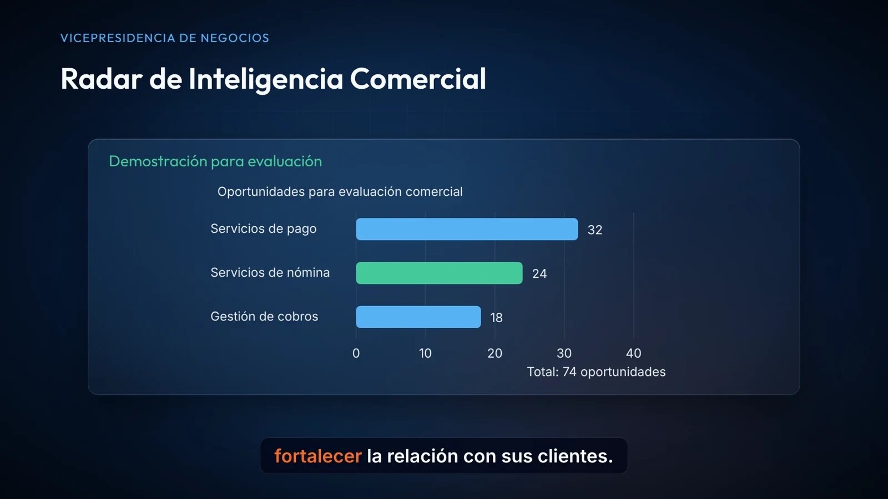 | 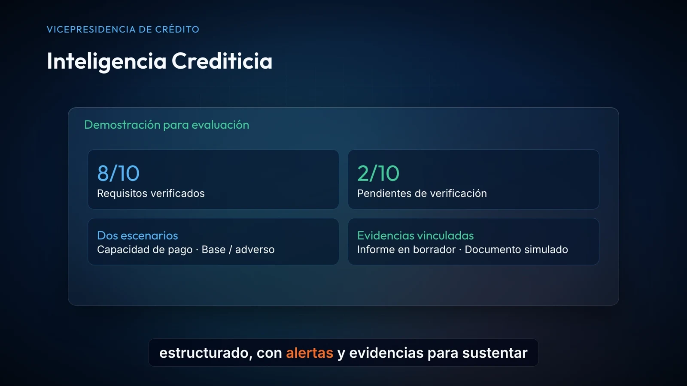 | 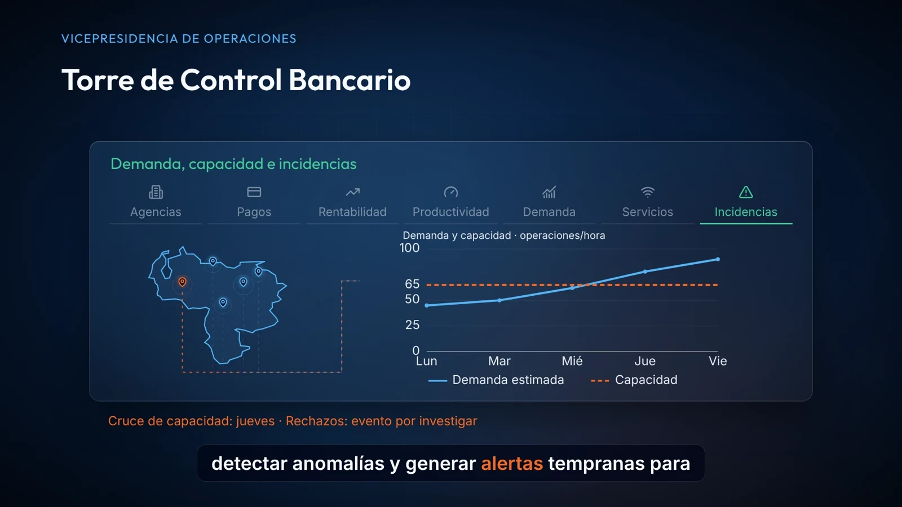 |
| **Simulador de Impacto Estratégico** | **Radar de Inteligencia Financiera** | **Cinco áreas → Banco de Proyectos** |
| 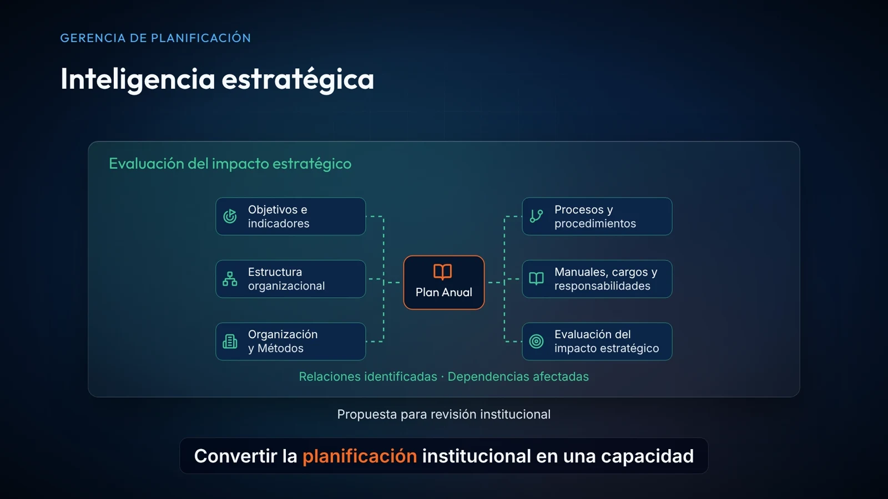 | 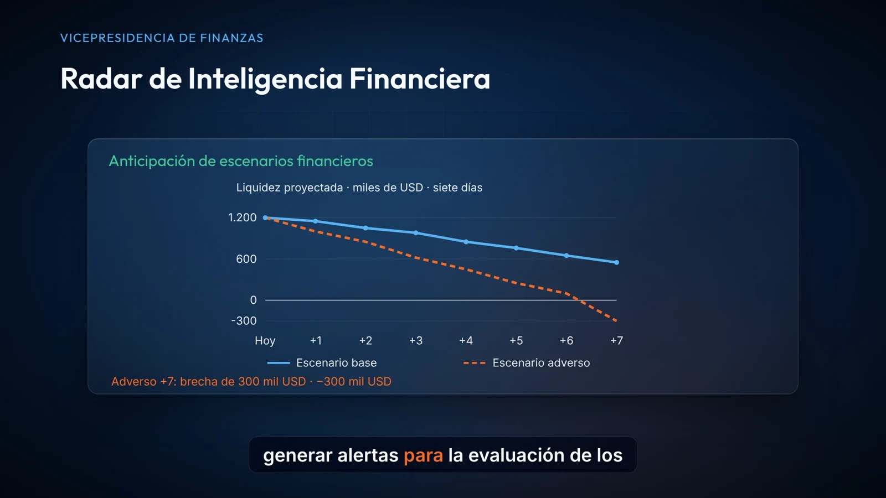 | 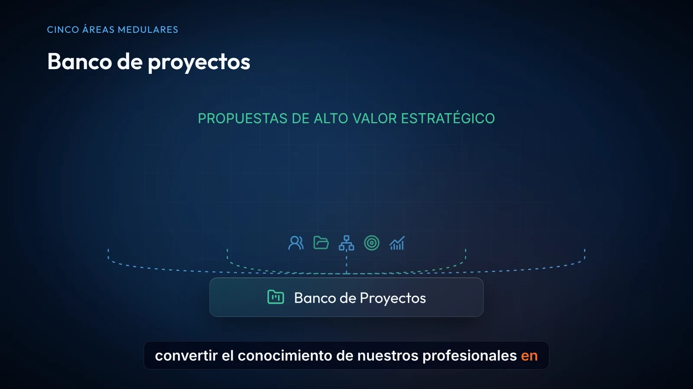 |

### Galería V1 conservada

| Apertura | Isabel | Antecedente bancario | Créditos |
|---|---|---|---|
| [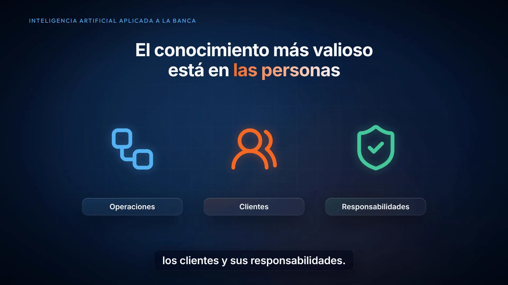](https://vimeo.com/user265304725/diplomado-ia-banca-vzla?share=copy&fl=sv&fe=ci) | 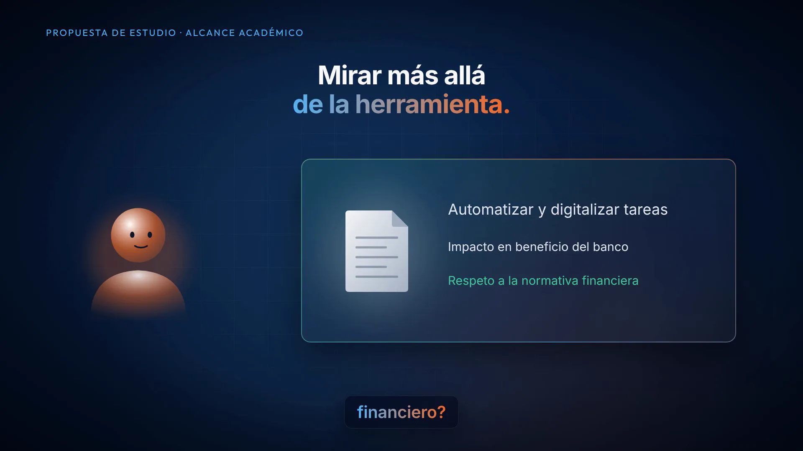 | 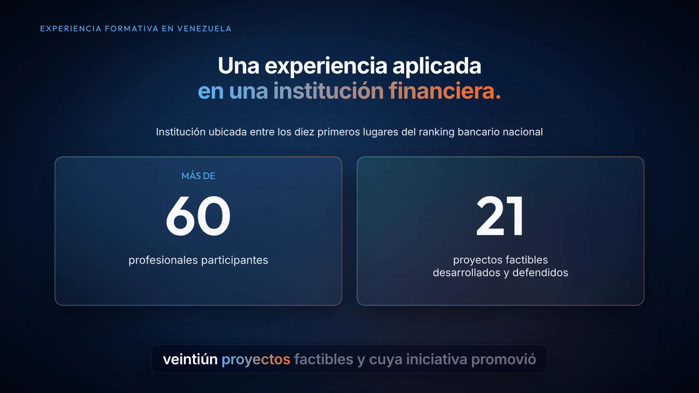 | 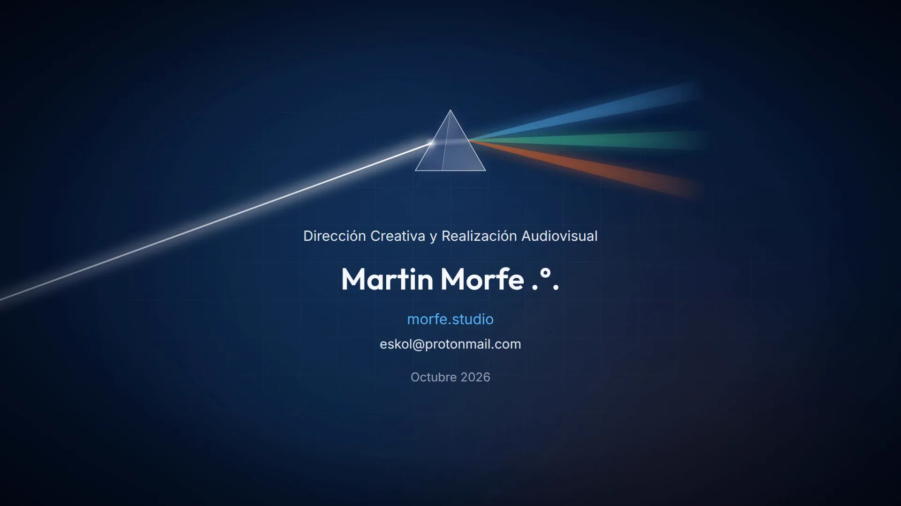 |

## Arquitectura e inserción quirúrgica

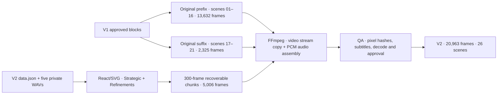

Los componentes globales y las escenas V1 permanecen intactos. V2 inserta **16A–16E después de Isabel y antes del antecedente bancario**. Las escenas 17/18 conservan su locución original continua. Véanse [arquitectura](docs/ARCHITECTURE.md), [secuencia narrativa](docs/SCENE-BY-SCENE.md) y [sincronización por palabras](docs/AUDIO-SYNCHRONIZATION.md).

## Reproducir y modificar

```bash
git clone https://github.com/mmorfe-engineer/diplomado-ia-banca-motion.git
cd diplomado-ia-banca-motion
npm ci
npm run typecheck
npm run docs:check
npm run studio
```

Studio registra `V2-negocios`, `V2-credito`, `V2-operaciones`, `V2-planificacion`, `V2-finanzas` y `DiplomadoIA-V2-Estrategico`, además del bloque original de revisión V1.

```bash
# V1: select the original block (other choices: 03-06, 07-10, 11-16)
npm run studio -- --props='{"block":"17-21"}'

# Authorized private media required for full audiovisual output
npm run v2:render
npm run v2:assemble
npm run v2:qa
```

**Reproducible desde el repositorio público:** instalación, typecheck, validación documental e inspección del código. La producción requiere voces y SFX privados, pistas V1 aprobadas, PCM, acceso a fuentes tipográficas y configuración local de navegador/FFmpeg. Disponer del código no garantiza un re-render idéntico bit a bit. [Comandos y límites](docs/REPRODUCIBILITY.md) · [Build/render](docs/BUILD-AND-RENDER.md) · [Guía de modificación](docs/MODIFICATION-GUIDE.md).

## Verificación y custodia

| Evidence | Record |
|---|---|
| Definitive approval and exact metrics | [approval.json](deliverables/v2/approval.json) |
| Technical QA and V1 pixel preservation | [qa-v2.json](deliverables/v2/qa-v2.json) |
| Publication manifests | [MANIFEST.json](deliverables/v2/MANIFEST.json) |
| Final Spanish subtitles | [diplomado-ia-v2.srt](deliverables/v2/diplomado-ia-v2.srt) |
| Local and clean-environment validation | [closure-validation.json](deliverables/v2/closure-validation.json) |
| Scope, decisions, release and recovery | [PROJECT-CLOSURE-V2.md](docs/PROJECT-CLOSURE-V2.md) |

V2 SHA-256: `06665a81e4968434acac12cb9c319d71d1787b42fceb1b8e207076fdcf4d8be5`
V1 SHA-256: `0f9d610c65a5663a3ae0ab380c309fcf256339997ee4f6d4c5f6c07b1b7c9b19`

El QA automatizado incluye decodificación completa y comparación de fotogramas originales; la inspección interna de imagen fue por muestreo real. La aprobación audiovisual definitiva fue emitida posteriormente por dirección. Typecheck no sustituye el QA de ejecución o de medios. [Métodos y límites](docs/QA-AND-VALIDATION.md).

## Alcance y derechos

Los cinco casos son demostraciones conceptuales y propuestas de proyecto, **no soluciones bancarias productivas implementadas**. Cifras, posiciones y marcadores son ilustrativos y no representan resultados reales del banco. Las salidas apoyan la evaluación humana. [Procedencia de recursos](docs/ASSET-PROVENANCE.md).

© 2026 Martin Morfe · morfe.studio. Todos los derechos reservados sobre los elementos audiovisuales originales. [LICENSE](LICENSE) se conserva sin cambios: MIT se limita al código fuente; voces, nombres, logotipos y medios privados mantienen sus derechos existentes. No se concede una nueva licencia abierta para assets audiovisuales.

**Dirección Creativa y Realización Audiovisual**
Martin Morfe .°. · morfe.studio · [eskol@protonmail.com](mailto:eskol@protonmail.com)

[CREDITS](docs/CREDITS.md) · [Third-party notices](docs/THIRD_PARTY_NOTICES.md) · [Release process](docs/RELEASE-PROCESS.md) · [Changelog](docs/CHANGELOG.md)
