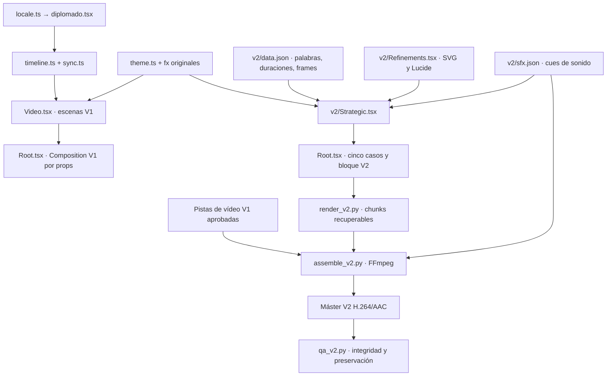
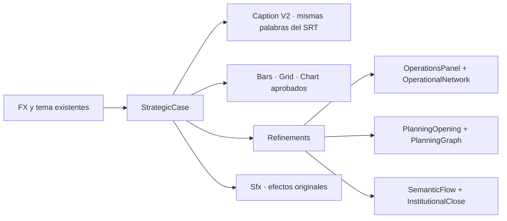
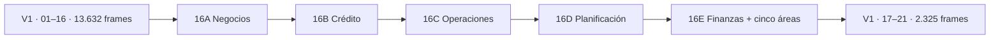

# Arquitectura V1–V2

V1: 21 escenas, 19 locuciones, cinco bloques aprobados y 15.957 fotogramas. V2 conserva ese vídeo e inserta un bloque autónomo de cinco escenas y locuciones: 26 escenas, 24 voces y 20.963 fotogramas. El máster es una salida de ensamblaje; no existe una composición que re-renderice las 26 escenas juntas.

## Componentes y datos

`Person`, `Glass`, `Background`, `Title`, `Grad`, `Doc`, `Prism`, `InstitutionalIcon` y los FX V1 no se alteraron. La V2 utiliza `Person` con desplazamiento, mirada, expresión y escala locales; iconos Lucide funcionales; mapas world-atlas ISO 862; grafo con anclajes en bordes; gráficos SVG deterministas.

V2 implementa su lector `cue` y su `Caption` local para no alterar `L`, `SCENES`, IDs o captions V1. Cada `Sequence` reinicia el tiempo local del caso. Las composiciones registradas son `V2-negocios`, `V2-credito`, `V2-operaciones`, `V2-planificacion`, `V2-finanzas` y `DiplomadoIA-V2-Estrategico`.

## Inserción y custodia

Se concatena vídeo sin recodificar V1. El vídeo V2 armoniza metadatos SPS a BT.470BG/rango TV mediante copia de flujo. A 48 kHz y 30 fps hay 1.600 muestras por frame. La mezcla PCM conserva el prefijo/sufijo original; la salida AAC se codifica de nuevo. Las escenas 17/18 mantienen una única locución continua y sus 493 frames de separación visual interna.

[Build y render](BUILD-AND-RENDER.md) · [Sincronización](AUDIO-SYNCHRONIZATION.md) · [QA](QA-AND-VALIDATION.md).
