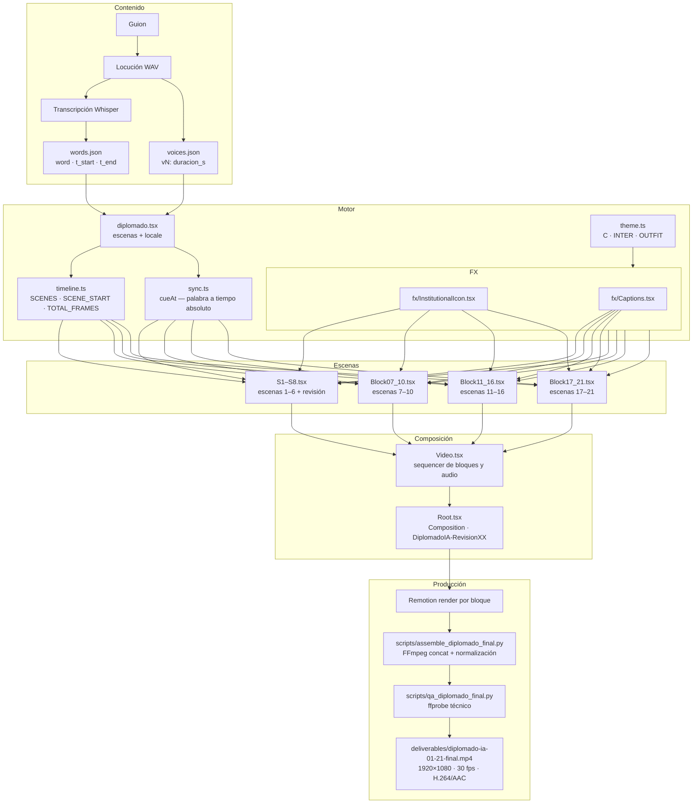
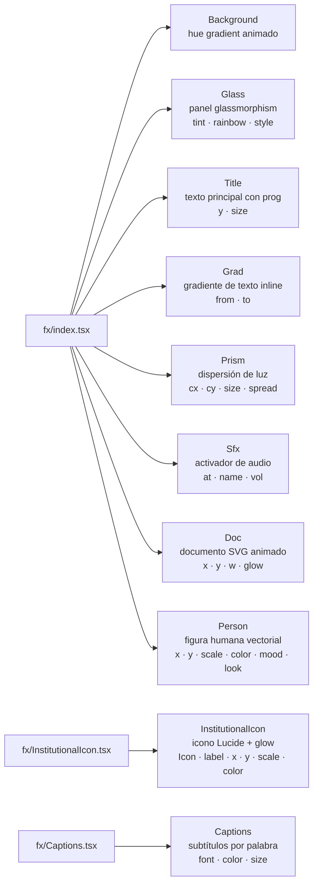
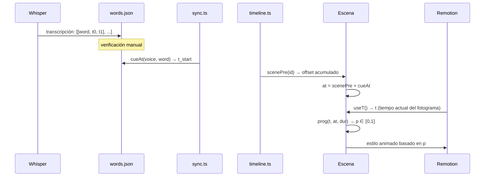

# Arquitectura del sistema

## Visión general

El proyecto es un motor de motion graphics programático construido sobre React y Remotion. No existe una línea de tiempo manual ni un editor de video. Cada fotograma es el resultado de evaluar funciones React con un valor de tiempo `t` (número de segundos desde el inicio de la composición).

La producción se organiza en **21 escenas** agrupadas en **5 bloques de render**. El ensamblaje final y la normalización de audio se realizan con FFmpeg.

---

## Diagrama general



---

## Módulos principales

### `src/lib.ts`

Funciones de animación y utilidades globales.

| Export | Tipo | Descripción |
|---|---|---|
| `FPS` | `number` | Constante: 30 fps |
| `useT()` | hook | Tiempo en segundos desde el inicio de la composición |
| `prog(t, at, dur)` | función | Interpolación [0..1] entre `at` y `at+dur` |
| `keys(t, keyframes)` | función | Interpolación entre fotogramas clave |

### `src/theme.ts`

Paleta de colores y tipografías. Exporta el objeto `C` con todos los tokens de color y las cadenas `INTER` / `OUTFIT` que referencian las familias tipográficas cargadas desde Google Fonts.

### `src/locale.ts` + `src/locales/diplomado.tsx`

Sistema de localización y configuración de escenas. `diplomado.tsx` selecciona el bloque de revisión desde `getInputProps().block` y construye el arreglo `scenes[]` con ids, voz, pre-roll y cola para ese bloque.

### `src/timeline.ts`

Calcula a partir de `L.scenes` y `L.voices`:

- `SCENES[]` — cada escena con duración total en segundos
- `SCENE_START{}` — offset acumulado por escena
- `TOTAL_FRAMES` — total de fotogramas de la composición
- `scenePre(id)` — pre-roll de una escena (tiempo antes de la locución)

### `src/sync.ts`

Expone `cueAt(voice, word)` que busca en `words.json` el timestamp de inicio de una palabra dentro de una locución. El resultado se suma al `scenePre` de la escena para obtener el tiempo absoluto de un cue de animación.

```typescript
const at = scenePre('s7') + cueAt('v7', 'fortalecer');
const p  = prog(t, at, 1.1);   // [0..1] a partir de esa palabra
```

---

## Bloques de render y composiciones

| Bloque | Composición Remotion | Escenas |
|---|---|---|
| 01-02 (default) | `DiplomadoIA-Revision01-02` | s1, s2 |
| 03-06 | `DiplomadoIA-Revision03-06` | s3, s4, s5, s6 |
| 07-10 | `DiplomadoIA-Revision07-10` | s7, s8, s9, s10 |
| 11-16 | `DiplomadoIA-Revision11-16` | s11, s12, s13, s14, s15, s16 |
| 17-21 | `DiplomadoIA-Revision17-21` | s17_18, s19, s20, s21 |

Para renderizar un bloque diferente al default se pasa `--props='{"block":"07-10"}'` al CLI de Remotion.

---

## Jerarquía de componentes FX



---

## Flujo de datos de sincronización



---

## Decisiones de arquitectura relevantes

| Decisión | Justificación |
|---|---|
| Render por bloques, no un render monolítico | Permite interrumpir y reanudar; cada bloque es verificable independientemente |
| `words.json` con triple `[word, t0, t1]` | Permite buscar por palabra y número de ocurrencia simultáneamente |
| `voices.json` separado de `scenes.json` | La duración de locución es un dato de audio medido por ffprobe; la escena puede cambiar sin tocar la locución |
| Locale por bloque (no por escena) | Reduce el tamaño de la composición cargada por Remotion en cada render |
| Animaciones con `prog()` lineal | Simplicidad y predictibilidad; efectos visuales con matemáticas directas, sin librerías de spring |

---

## Referencia cruzada

- [SCENE-BY-SCENE.md](SCENE-BY-SCENE.md) — detalle de cada escena
- [VISUAL-SYSTEM.md](VISUAL-SYSTEM.md) — paleta, tipografías y componentes FX
- [AUDIO-SYNCHRONIZATION.md](AUDIO-SYNCHRONIZATION.md) — pipeline de sincronización de voz
- [BUILD-AND-RENDER.md](BUILD-AND-RENDER.md) — comandos de render y ensamblaje
- [REPRODUCIBILITY.md](REPRODUCIBILITY.md) — requisitos y limitaciones para reproducir
