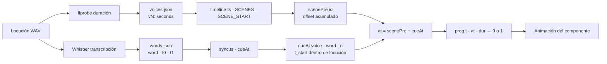

# Sincronización de audio

## Arquitectura general

La sincronización de animaciones con la voz se implementa en tres capas:

1. **Datos** — `words.json` (timestamps de palabras) y `voices.json` (duración de locuciones)
2. **Cálculo** — `sync.ts` (`cueAt`) y `timeline.ts` (`scenePre`, `SCENE_START`)
3. **Animación** — `prog(t, at, dur)` en cada componente de escena



---

## Estructura de `words.json`

Ubicación: `src/locales/diplomado/words.json`

```json
{
  "v1": [
    ["Al",          0.00, 0.16],
    ["hablar",      0.16, 0.34],
    ["de",          0.34, 0.54],
    ["transformación", 0.54, 1.20],
    ...
  ],
  "v2": [...],
  "v17_18": [...]
}
```

Cada entrada es un triple `[palabra, t_inicio, t_fin]` donde los tiempos son segundos desde el inicio de esa locución (no desde el inicio del film).

**Generación:** transcripción automática con Whisper (`scripts/transcribe.py`) + verificación manual.

---

## Estructura de `voices.json`

Ubicación: `src/locales/diplomado/voices.json`

```json
{
  "v1":  27.010625,  "v2":  23.170625,  "v3":  24.189396,
  "v4":  29.231021,  "v5":  28.525729,  "v6":  29.387750,
  "v7":  29.570625,  "v8":  28.186125,  "v9":  27.637563,
  "v10": 24.685729,  "v11": 29.962458,  "v12": 25.312667,
  "v13": 22.282458,  "v14": 26.435917,  "v15": 26.827750,
  "v16": 26.514292,  "v17_18": 32.130625, "v19": 24.999188,
  "v20":  5.564083,  "silence": 10
}
```

Valores medidos con `ffprobe` sobre los archivos WAV originales.

---

## `sync.ts` — función `cueAt`

Busca en `words.json[voice]` la n-ésima aparición de `word` y retorna su `t_inicio`.

```typescript
// Cue para animar en la palabra "fortalecer" de la escena 7
const at = scenePre('s7') + cueAt('v7', 'fortalecer');
const p  = prog(t, at, 1.1);   // [0..1] en 1.1 s a partir de esa palabra
```

Cuando una palabra aparece más de una vez (ej: "veinte" en v10):

```typescript
// Primera aparición de "veinte" en v10
const p1 = prog(t, at(10, 'veinte', 0), 0.9);
// Segunda aparición de "veinte" en v10
const p2 = prog(t, at(10, 'veinte', 1), 0.9);
```

---

## `timeline.ts` — duración y offsets

```typescript
// Duración de una escena = pre + voice_dur + tail (redondeado a fotogramas)
dur = Math.ceil((end + tail) * FPS) / FPS

// SCENE_START["s7"] = suma de duraciones de escenas anteriores
// scenePre("s7")    = SCENE_START["s7"] + s7.pre
```

**Escena 5 (locale es) — locución doble:**

```json
{
  "id": "s5", "voice": "v5a", "pre": 0.8, "tail": 1.6,
  "extra": { "voice": "v5b", "gap": 1.0 }
}
```
En el locale `diplomado` el bloque 03-06 usa `v5` unificado.

---

## Escenas 17-18: locución compartida

`v17_18.wav` (32.13 s) sirve a ambas escenas. La separación visual ocurre en el fotograma 493.

```typescript
export const SPLIT_17_18 = 493;  // con 18 fotogramas de pre-roll

// S18 corrige el tiempo para alinear cues con v17_18
const local = useT();
const t     = local + SPLIT_17_18 / FPS;
```

---

## Efectos de sonido (SFX)

Activados con `<Sfx at={...} name="..." vol={...} />`. Los archivos WAV están en `public/sfx/` (excluidos del repositorio; se regeneran con `npm run sfx`).

| Nombre | Uso típico |
|---|---|
| `pop` | Aparición de elementos (cards, iconos) |
| `whoosh` | Transición de fase dentro de escena |
| `ding` | Punto de llegada, resolución |
| `shimmer` | Efectos de luz, Prism |
| `rise`, `boom`, `click`, `key`, `pad` | Usos especiales |

---

## Actualizar sincronización al reemplazar una locución

1. Medir duración: `ffprobe -v quiet -show_entries format=duration -of csv="p=0" public/voice/diplomado/vN.wav`
2. Actualizar `voices.json` con el valor exacto
3. Transcribir: `python3 scripts/transcribe.py` → actualizar `words.json`
4. Verificar cues críticos escuchando la locución
5. `npm run typecheck`
6. `npm run studio` para verificar visualmente
7. Re-renderizar el bloque afectado

Ver [MODIFICATION-GUIDE.md](MODIFICATION-GUIDE.md) y [BUILD-AND-RENDER.md](BUILD-AND-RENDER.md).
