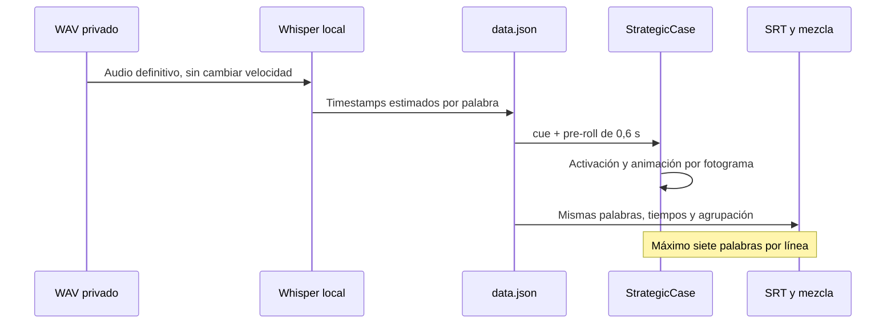

# Sincronización de audio V1–V2

V1 usa `src/locales/diplomado/words.json`, `voices.json`, `sync.ts` y `timeline.ts`. V2 mantiene esos archivos y añade `src/v2/data.json`: cinco registros con palabras `[texto, inicio, fin]`, duración medida y frames por caso. Su `cue` normaliza signos y tildes y exige que exista la palabra; permite desambiguar ocurrencias.

Por caso: `frames = ceil((duración + 0,6 + 0,9) × 30)`. La suma V2 es 5.006 frames. `lines()` agrupa hasta siete palabras y prolonga cada línea como máximo 0,6 s, limitada por la siguiente. El ensamblador reproduce esa misma regla al exportar SRT. El subtitulado quemado reserva la zona inferior, bottom 54 px y fuente 40 px.

`src/v2/sfx.json` contiene 22 eventos con cue, volumen y fotograma local/global. Lo usan `Sfx` en la composición y FFmpeg en la mezcla; el vídeo de chunks se renderiza mudo. Los efectos originales no compiten con las voces: volúmenes configurados entre 0,055 y 0,08, salvo shimmer a 0,055.

Las cinco voces definitivas, duraciones, timestamps y SRT se conservaron durante el refinamiento. Whisper proporciona estimaciones, no alineación fonética certificada. Crédito no incluía TXT fuente: se transcribió su MP3; las otras cuatro voces se contrastaron con sus TXT. Dos correcciones léxicas de reconocimiento de Planificación están documentadas en producción. No se sintetizaron voces sustitutas.

V2 mantiene los 178 cues previos a la inserción, añade 61 y desplaza los últimos 25 de V1 por 5.006/30 s: 264 cues. La locución V1 de escenas 17/18 permanece continua. Los créditos siguen sin voz.

La mezcla nueva: +1,6 dB uniformes sobre voces/pad/SFX, sin cambio de velocidad ni compresión dinámica. Máster medido: −16,2 LUFS integrados y aproximadamente −4,0 dBTP. Se compara audio V1 por muestras en PCM; la pista AAC final no es idéntica binariamente porque se recodifica.

[Reproducción autorizada](REPRODUCIBILITY.md) · [QA](QA-AND-VALIDATION.md).
