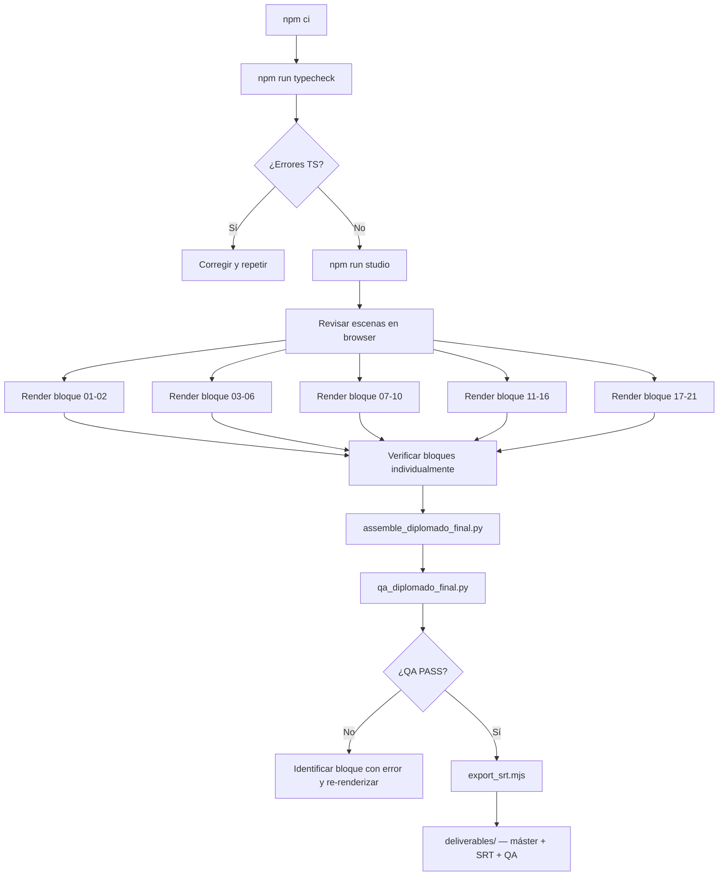

# Build y render

## Prerrequisitos

| Herramienta | Verificación | Uso |
|---|---|---|
| Node.js ≥ 18 | `node --version` | npm, Remotion |
| npm | `npm --version` | gestión de dependencias |
| FFmpeg | `ffmpeg -version` | render, ensamblaje, normalización |
| ffprobe | `ffprobe -version` | verificación de duración y QA técnico |
| Python 3 | `python3 --version` | scripts de ensamblaje y QA |
| Archivos WAV | `ls public/voice/diplomado/` | locuciones v1–v20 + v17_18 |
| SFX WAV | `ls public/sfx/` | efectos de sonido (generados con `npm run sfx`) |

---

## Instalación

```bash
git clone https://github.com/mmorfe-engineer/diplomado-ia-banca-motion.git
cd diplomado-ia-banca-motion
npm ci
```

Si los archivos WAV no están presentes, coloca las locuciones originales en `public/voice/diplomado/` con los nombres `v1.wav` … `v20.wav` y `v17_18.wav`.

Para regenerar los efectos de sonido:

```bash
npm run sfx
```

---

## Verificación de tipos

```bash
npm run typecheck
```

Ejecutar siempre antes de render. Si hay errores de TypeScript, el render puede producir fotogramas incorrectos sin advertencias visibles.

---

## Vista previa en Remotion Studio

```bash
npm run studio
```

Abre `http://localhost:3000`. La composición por defecto es `DiplomadoIA-Revision01-02` (escenas 1–2).

Para previsualizar otros bloques:

```bash
# Bloque 03-06 — escenas 3 a 6
npm run studio:03-06
# Equivalente manual:
npx remotion studio src/index.ts --props='{"block":"03-06"}'
```

---

## Render por bloques

### Bloque 01-02 (default)

```bash
npm run render:review
# Salida: out/revision/diplomado-ia-escenas-01-02.mp4
```

### Bloque 03-06

```bash
npm run render:03-06
# Salida: out/revision-03-06/diplomado-ia-escenas-03-06.mp4
```

### Bloques 07-10, 11-16, 17-21

Usar los scripts de Python directamente (requieren FFmpeg para chunks paralelos):

```bash
python3 scripts/render_diplomado_blocks.py --block 07-10
python3 scripts/render_diplomado_blocks.py --block 11-16
python3 scripts/render_diplomado_blocks.py --block 17-21
```

Cada render deposita el MP4 del bloque en `out/` con la estructura de directorios del proyecto original.

---

## Ensamblaje del máster completo

Una vez que todos los bloques están renderizados y verificados:

```bash
python3 scripts/assemble_diplomado_final.py --final
```

Este script:
1. Lee los bloques MP4 de los 5 grupos
2. Normaliza el audio con FFmpeg (LUFS target)
3. Concatena con re-encode H.264/AAC
4. Deposita el resultado en `out/finalizacion-01-21/diplomado-ia-01-21-final.mp4`

Tiempo estimado: 10–30 minutos según hardware.

---

## QA técnico post-render

```bash
python3 scripts/qa_diplomado_final.py
```

Verifica con ffprobe:
- Dimensiones: 1920 × 1080
- Frame rate: 30 fps
- Códec video: H.264 (libx264)
- Códec audio: AAC
- Canales de audio: 2 (estéreo)
- Duración: dentro del rango esperado (~531 s)
- Bitrate de audio: ≥ 320 kbps

Resultados guardados en `deliverables/qa-tecnico.json`.

---

## Exportar subtítulos SRT

```bash
node scripts/export_srt.mjs
```

Genera `deliverables/diplomado-ia-01-21.srt` con los subtítulos sincronizados desde `words.json`.

---

## Flujo de trabajo completo



---

## Notas importantes

- El máster aprobado (`deliverables/diplomado-ia-01-21-final.mp4`, 90 MB) no está en el repositorio; está en Vimeo.
- Los comandos `npm run render:*` son para **revisión de bloques**, no para el render completo del piloto.
- No re-renderizar desde esta copia sin verificar que las rutas en los scripts apuntan al directorio correcto.
- El render completo requiere las 19 locuciones WAV originales; sin ellas, el audio no se incluirá.

Ver [REPRODUCIBILITY.md](REPRODUCIBILITY.md) para el contexto completo de recursos necesarios.
