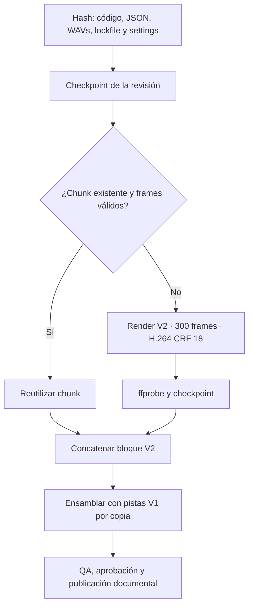

# Build, revisión y render

Requisitos verificados: Node 26.1.0 en producción, npm con lockfile, Python 3, FFmpeg/ffprobe y Chrome Headless Shell. Remotion 4.0.538, React 19.1.0 y TypeScript 5.8.3 se fijan en package-lock. El typecheck no necesita voces.

```bash
npm ci
npm run typecheck
npm run docs:check
npm run studio
```

En Studio: seleccionar una de las seis composiciones V2. Para V1, la propiedad `block` selecciona 01-02, 03-06, 07-10, 11-16 o 17-21:

```bash
npm run studio -- --props='{"block":"17-21"}'
npm run render:review
npm run render:03-06
```

Los dos renders anteriores son revisiones parciales V1 y requieren sus medios privados; no generan una película completa. Los scripts históricos V1 tienen supuestos/rutas de producción y deben inspeccionarse antes de usarlos. La V1 aprobada se recupera desde sus pistas y mezcla conservadas, no desde Vimeo.

## Producción V2 autorizada

```bash
# Configure paths to authorized read-only sources and a local browser
export V2_V1_ROOT=/ruta/a/copia-aprobada-V1
export V2_PACKAGE=/ruta/a/paquete-contextual
export V2_BROWSER=/ruta/a/chrome-headless-shell

# Only after an authorized new recording: never rerun for this approved release
/path/to/python-with-faster-whisper scripts/prepare_v2.py
/path/to/python-with-faster-whisper scripts/review_v2_words.py

# Reuse committed timing data and definitive WAVs for the approved version
python3 scripts/render_v2.py controls
npm run v2:render
npm run v2:assemble
npm run v2:artifacts
npm run v2:qa
```

`prepare_v2.py` requires the cached multilingual small model and faster-whisper; [ENTORNO.txt](v2/ENTORNO.txt) records versions. It converts copies to 48 kHz/stereo/24-bit PCM without changing speed. Keep original MP3s. `review_v2_words.py` reconciles recognition with reviewed text; it does not establish that a changed script matches audio without review. The approved JSON already contains reviewed timing; do not regenerate it casually.

Copy the five original SFX (pop/click/whoosh/ding/shimmer) to `public/sfx/`; `assemble_v2.py` also reads the approved V1 pad and video tracks. `npm run sfx` regenerates effects but does not promise identical noise samples. No private media are downloaded by the build.

## Recuperación por chunks



Nunca reusar un checkpoint de otra revisión sin demostrar que los frames afectados no cambian. En cierre de release no se renderiza: se verifica el MP4 aprobado por hash, decodificación y comparación de frames. Las rutas locales exactas figuran en [PROJECT-CLOSURE-V2.md](PROJECT-CLOSURE-V2.md).
