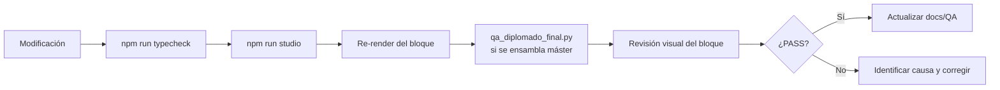

# Control de calidad y validación

## Resultados del QA del piloto aprobado

| Check | Resultado | Herramienta |
|---|---|---|
| TypeScript | PASS | `tsc --noEmit` |
| Dimensiones del video | PASS — 1920×1080 | ffprobe |
| Frame rate | PASS — 30 fps | ffprobe |
| Duración total | PASS — 531.9 s (15.957 fotogramas) | ffprobe |
| Códec video | PASS — H.264 | ffprobe |
| Códec audio | PASS — AAC | ffprobe |
| Canales de audio | PASS — 2 (estéreo) | ffprobe |
| Fuentes de audio | PASS — 19/19 WAV presentes | `qa_diplomado_review.py` |
| Revisión visual por muestreo | PASS | Inspección manual |
| Auditoría institucional | PASS — iconografía correcta | `audit_institutional.mjs` |

Informes completos en `deliverables/`:
- `qa-tecnico.json` — métricas ffprobe
- `qa-visual.json` — muestra visual con observaciones
- `qa-final.json` — resumen consolidado

---

## Ejecutar QA

### Verificación TypeScript

```bash
npm run typecheck
```

Debe retornar sin errores. Detecta:
- Tipos incorrectos en props de componentes
- Referencias a propiedades inexistentes
- Errores de importación

### QA técnico del video (ffprobe)

```bash
python3 scripts/qa_diplomado_final.py
```

Verifica dimensiones, fps, códecs, bitrate y duración. Requiere un MP4 en la ruta configurada en el script.

### Revisión de continuidad de audio

```bash
python3 scripts/qa_diplomado_review.py
```

Verifica que los archivos WAV de locución están presentes y son decodificables.

### Auditoría de iconografía institucional

```bash
node scripts/audit_institutional.mjs
```

Verifica que los íconos institucionales mapeados en el código corresponden a la especificación de escenas aprobada.

---

## Alcance y limitaciones del QA

**Lo que el QA verifica:**
- Integridad técnica del video exportado (sin fotogramas corruptos detectables por ffprobe)
- Presencia de todos los archivos de audio fuente
- Tipos TypeScript sin errores
- Dimensiones y parámetros técnicos del máster

**Lo que el QA NO verifica:**
- Revisión humana continua de todos los 15.957 fotogramas
- Correctitud semántica del texto en pantalla (tipografía, ortografía)
- Sincronización exacta por escena bajo escucha crítica
- Calidad de la experiencia de visualización completa

**Declaración de QA:** el máster `diplomado-ia-01-21-final.mp4` pasó QA técnico automatizado y revisión visual por muestreo. No equivale a un visionado humano completo ni a un render limpio desde cero en este workspace.

---

## Proceso de QA para una modificación



---

## Hashes SHA-256

Los hashes del máster y entregables están en `deliverables/MANIFEST.json`. Para verificar la integridad del máster localmente:

```bash
sha256sum deliverables/diplomado-ia-01-21-final.mp4
# Comparar con el valor en MANIFEST.json
```
