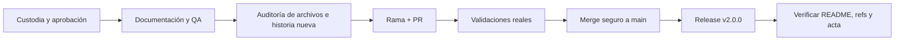

# Proceso de release y recuperación

1. Identificar aprobación y hash del máster. Preservar base, originales ElevenLabs, WAVs, SRT, tracks V1 y checkpoints en ubicaciones privadas.
2. Verificar cuenta mmorfe-engineer, remote exacto, main remoto, tag/release V1 y ausencia de conflictos. Registrar referencias antes de publicar.
3. Ejecutar typecheck, dependencias, validación de Mermaid/enlaces/imágenes, QA de medios, hashes y prueba de clon limpio. Auditar archivos y commits nuevos para excluir secretos y privados.
4. Crear commits Conventional Commits en feature/v2-strategic-use-cases, publicar la rama y abrir PR contra main. Revisar checks, diff y mergeability. Respetar protecciones; no usar force push ni borrar historia.
5. Integrar sólo si las comprobaciones pasan. Crear v2.0.0 sobre el commit integrado verificado, sin assets privados. No sobrescribir un tag/release existente.
6. Verificar README renderizado en GitHub, estado de PR/release, commit destino y que v1.0.0-pilot permanece intacto. Completar el acta con enlaces y SHA definitivos.

No adjuntar MP4/MP3/WAV privados a releases. Las imágenes autorizadas y reportes redistribuibles sí forman parte del repositorio. La publicación Vimeo V2 es independiente y permanece pendiente hasta contar con su URL real.

Si falla autenticación o protección: conservar la preparación local, registrar el bloqueo y dejar pendiente sólo la operación remota necesaria. Nunca cambiar visibilidad, credenciales, licencias o reglas de protección para forzar la publicación.

Recuperación: consultar el commit de release y sus manifiestos; restaurar recursos desde custodia, verificar SHA-256 y reanudar sólo chunks de la misma revisión. No descargar Vimeo ni reconstruir escenas V1 para recuperar el aprobado. [Acta](PROJECT-CLOSURE-V2.md).
